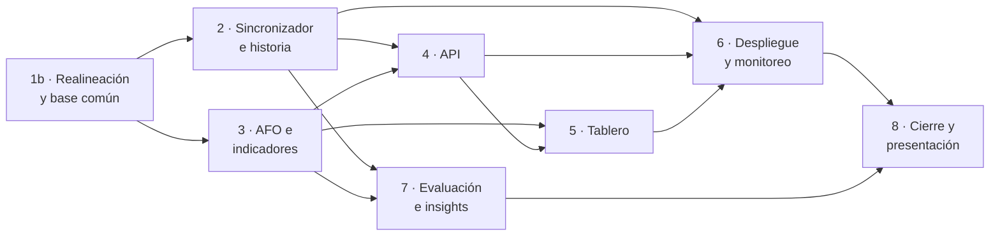
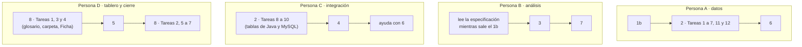

# Traspaso de `vivso-analitica` · PP3 · Grupo 8

**Preparado el 04/11/2026** para que el grupo termine el componente de Ciencia de Datos de PP3 trabajando cada uno con
su agente de programación. Empezá por acá.

## 1. Qué hay en esta carpeta

| Archivo | Para qué |
| :--- | :--- |
| `LEEME.md` | Este documento: estado, cómo arrancar, reglas, reparto y decisiones abiertas |
| `especificacion.md` | Qué tiene que hacer el servicio, con todas las decisiones tomadas (versión 4, alineada con el Java del 03/11/2026) |
| `planes/plan-1b-realineacion-y-base-comun.md` | Poner al día lo hecho con los cambios de Java y dejar la base común (**va primero**) |
| `planes/plan-2-sincronizador-e-historia.md` | Base propia, sincronizador, historia, origen MySQL, experimento de frecuencia |
| `planes/plan-3-afo-e-indicadores.md` | AFO por etapas, semáforo, los 17 indicadores y las respuestas JSON |
| `planes/plan-4-api.md` | API `/v1` con claves |
| `planes/plan-5-tablero.md` | Tablero Streamlit |
| `planes/plan-6-despliegue-y-monitoreo.md` | Docker, MySQL de prueba, monitoreo, informe semanal, Etapas 8 y 9 |
| `planes/plan-7-evaluacion-e-insights.md` | Mediciones y documentos de las Etapas 6 y 7 |
| `planes/plan-8-cierre-y-presentacion.md` | Glosario, carpeta de la cátedra, Ficha de PP3, presentación final |

**Esta carpeta no va al repositorio del entregable** (regla del grupo: las especificaciones y los planes no se suben
ahí; ver la sección 5). Vive en su propio repositorio, `https://github.com/enzopazzelli/vivso-analitica-traspaso`,
y cada uno lo clona **al lado** de su copia del entregable, con este nombre de carpeta (los planes la buscan así):

```powershell
git clone https://github.com/enzopazzelli/vivso-analitica.git
git clone https://github.com/enzopazzelli/vivso-analitica-traspaso.git traspaso-vivso-analitica
```

```
carpeta-de-trabajo/
├── vivso-analitica/            ← el repositorio del entregable de PP3
└── traspaso-vivso-analitica/   ← este repositorio: especificación y planes
```

Al marcar las casillas de un plan o actualizar la tabla de «Estado», hacé commit y push acá también, así el resto ve el
avance.

## 2. Estado al 04/11/2026

- **Hecho (Plan 1, 21/10/2026):** en `vivso-analitica/`, el dominio copiado del sistema de Desarrollo (etapas, estados,
  días hábiles con feriados), el esquema de las tablas, el origen vacío, el **origen simulado** completo (un mundo
  inventado con las mismas tablas y reglas que Java) y los documentos sobre el sistema de Desarrollo y el pedido.
- **Hecho (Plan 1b, 04/11/2026):** todo al día con la rama `develop` de Java (técnico asignado por el arquitecto,
  etapas prorrogadas que se pueden enviar, `RECHAZADA`, prórroga en revisión, la tabla 14 de **notificaciones**, nombre
  y apellido de usuarios) y la base común `analitica/historia.py`, que reconstruye la historia de las etapas desde las
  notificaciones. **174 pruebas en verde.** Lo que cambió respecto del plan está al principio de
  `planes/plan-1b-realineacion-y-base-comun.md`.
- **Ojo:** el 04/11 la rama **`main` de Java quedó casi vacía** (borraron carpetas a mano): se trabaja contra
  **`develop`**.
- **Falta:** los Planes 2 a 8. **El 2 y el 3 se pueden empezar ya, en paralelo.**
- **Pendiente de afuera:** la contraseña y el certificado del usuario de solo lectura `lector` (Desarrollo), las
  respuestas a las preguntas del pedido (Desarrollo), la devolución del área sobre el tablero, la fecha de la
  presentación final y el formato de la Ficha de PP3 (profesor).

Actualizá esta sección cuando termines un plan (fecha, plan, cantidad de pruebas).

| Plan | Estado | Quién | Fecha | Pruebas |
| :--- | :--- | :--- | :--- | ---: |
| 1 | Hecho | — | 21/10/2026 | 143 |
| 1b | Hecho | — | 04/11/2026 | 174 |
| 2 | Pendiente | | | |
| 3 | Pendiente | | | |
| 4 | Pendiente | | | |
| 5 | Pendiente | | | |
| 6 | Pendiente | | | |
| 7 | Pendiente | | | |
| 8 | Pendiente | | | |

## 3. Paso 0: preparar el entorno (una vez por persona)

1. **El código** está en `https://github.com/enzopazzelli/vivso-analitica` y esta carpeta en
   `https://github.com/enzopazzelli/vivso-analitica-traspaso` (los dos públicos, rama `main`). Para clonarlos alcanza
   con el enlace (sección 1). Para subir tus ramas, pedile a Enzo que te sume como colaborador con tu usuario de GitHub,
   o trabajá con un *fork* y un *pull request*.
2. **Python 3.13** y el entorno (Windows, PowerShell, desde `vivso-analitica/`):

   ```powershell
   py -3.13 -m venv .venv
   .venv\Scripts\python.exe -m pip install -r requirements-dev.txt
   .venv\Scripts\python.exe -m pytest -q
   .venv\Scripts\python.exe -m analitica simular --hasta 2026-10-15
   ```

   (En Mac o Linux: `python3.13 -m venv .venv`, `.venv/bin/python …`.) La guía paso a paso está en
   `vivso-analitica/docs/como-levantar-y-probar.md`.
3. **El `.env`.** Copiar `.env.example` a `.env`. Con el origen simulado no hace falta completar nada. La contraseña y
   el certificado de la base real llegan **por privado** y van solo en el `.env` de cada máquina; nunca en el
   repositorio, en el Drive ni en un chat grupal.
4. **El sistema de Desarrollo** (para consultar reglas): `https://github.com/PaganiB/vivso`, rama `develop`.

## 4. Cómo trabajar un plan con tu agente

1. **Un plan por persona y una rama por plan:** `git switch -c plan-2-sincronizador` (o el nombre del plan).
2. **Dale al agente los tres documentos** y pedile que ejecute el plan tarea por tarea. Un pedido que funciona:

   ```text
   Vas a trabajar en el repositorio vivso-analitica (Python 3.13, Windows, PowerShell). Leé primero, en este orden:
   1) ../traspaso-vivso-analitica/LEEME.md (reglas del equipo),
   2) ../traspaso-vivso-analitica/especificacion.md,
   3) ../traspaso-vivso-analitica/planes/<el plan>.md.
   Ejecutá el plan tarea por tarea, con las pruebas primero, y marcá cada casilla del plan al terminarla.
   Escribí todo en español (código, mensajes, documentos y commits). Antes de cada commit corré
   .venv\Scripts\python.exe -m pytest -q y verificá que todo pase. No agregues líneas Co-Authored-By, «Generated with»
   ni menciones a herramientas de IA en commits, código o documentos. Si algo del plan no coincide con el código o con
   el sistema de Desarrollo, parate y explicame la diferencia antes de seguir.
   ```

3. **Revisá lo que hace:** al final de cada tarea, que las pruebas pasen y que el cambio sea lo que dice el plan. El
   profesor acepta que usemos IA, pero pide **revisar los contenidos** antes de compartir.
4. **Al terminar el plan:** suite completa en verde, un *pull request* a `main`, y que **otra persona del grupo** lo
   revise antes de unirlo (con su agente, si quiere: «revisá esta rama contra el plan y la especificación»).
5. **Si el plan está mal o quedó viejo** (por ejemplo, Java volvió a cambiar): corregí el plan en la carpeta compartida,
   avisá al grupo y seguí. Los planes son una guía detallada, no un contrato.

## 5. Reglas del equipo

Valen para todos los planes (cada plan las repite en «Restricciones globales»):

- **Todo en español**, también los nombres en el código, los mensajes de error y los commits.
- **Lenguaje llano** en los documentos: el profesor pidió orientarlos al público general; explicar cada término técnico
  o mandarlo al glosario. Decir qué adaptación haría falta en vez de «no se puede».
- **Datos personales:** el servicio lee lo que carga Java salvo tokens, contraseñas y sus hashes; de familias y
  familiares, **solo conteos**. Ningún dato real va al repositorio, al Drive compartido, a la presentación ni a la demo
  pública: para todo eso se usa el simulado.
- **El servicio nunca escribe en la base de Desarrollo.**
- **Pruebas primero**, ninguna prueba usa la red, y la suite completa en verde antes de cada commit.
- **Sin rastros del trabajo con IA en el repositorio:** nada de `Co-Authored-By`, «Generated with», menciones a
  herramientas de IA, ni estas especificaciones y planes (las pruebas de `tests/test_documentos.py` controlan los
  documentos). Muchos agentes agregan esas líneas solos: revisá cada mensaje de commit.
- **Commits** en español, descriptivos, uno por tarea («Calcular el AFO por etapas con el plan contra lo real»).
- **Diagramas Mermaid** en los documentos (uno general y uno por cada flujo chico), compatibles con Mermaid 11 (el de
  GitHub).
- El núcleo (`analitica/`) no importa `fastapi` ni `streamlit`: la API va en `analitica/api/` y el tablero en `tablero/`.

## 6. Los planes y el reparto sugerido



| Plan | Tareas | Tamaño | Depende de |
| :--- | ---: | :--- | :--- |
| 1b | 10 | chico | — |
| 2 | 12 | grande | 1b |
| 3 | 14 | grande | 1b |
| 4 | 7 | mediano | 2 y 3 |
| 5 | 8 | mediano | 3 (y 4 para el modo API) |
| 6 | 8 | mediano | 2, 4 y 5 |
| 7 | 8 | mediano | 2 y 3 |
| 8 | 7 | mediano (documentos y coordinación) | todos |

**Reparto sugerido para cuatro personas** (los roles los eligen ustedes):



- El **Plan 1b va primero** y conviene que lo haga una sola persona rápido: todos los demás dependen de él.
- Las Tareas 8 a 10 del Plan 2 (tablas de Java, origen MySQL, API REST) solo dependen del 1b: se pueden hacer en
  paralelo con el resto del Plan 2.
- La presentación (Plan 8, Tareas 5 y 6) es de todos.
- Conviene que una persona coordine: une las ramas, mantiene la tabla de «Estado» y sigue los pendientes de afuera.

## 7. Pendientes con otros

| Con quién | Qué | Qué hacer si no llega |
| :--- | :--- | :--- |
| Desarrollo | Contraseña y certificado (CA) del usuario `lector` | La lectura real (criterio 7) queda pendiente; el MySQL de prueba del Plan 6 ya ejercita las consultas |
| Desarrollo | ¿Cuál es la rama vigente, ahora que `main` quedó vacía? | Seguir con `develop` |
| Desarrollo | Preguntas del pedido (zona horaria, `RECHAZADA`, etapa en la notificación, tipo de organización para municipios, feriados) | Se documentan como supuestos y limitaciones |
| Área | Devolución sobre el tablero (criterio 8) | Queda «pendiente» con la guía de preguntas preparada |
| Profesor | Fecha de la presentación final y formato de la Ficha de PP3 | Usar el formato de la Ficha de PP2 |

## 8. Decisiones abiertas

Cada plan termina con sus decisiones; estas son las generales. La opción recomendada va primero.

1. **Permisos para subir cambios:** los repositorios son públicos, pero para subir ramas hay que ser colaborador.
   Sumar a los cuatro como colaboradores (recomendado) o que cada uno trabaje con *fork* y *pull request*.
2. **Frecuencia de sincronización:** se decide con el experimento del Plan 2 (la especificación propone 30 minutos).
3. **Rechazo en el simulador:** en 0 mientras nadie pueda rechazar en Java (recomendado).
4. **Demo pública:** Streamlit Community Cloud con el simulado (recomendado) o solo en local.

## 9. Dónde está cada cosa

| Qué | Dónde |
| :--- | :--- |
| El entregable de PP3 | `https://github.com/enzopazzelli/vivso-analitica` |
| Esta carpeta: especificación y planes | `https://github.com/enzopazzelli/vivso-analitica-traspaso` |
| Antecedente de PP1 y PP2 (análisis de VISOC, simulador y tablero anteriores) | repositorio `pp-vivso-python` (no se modifica) |
| Sistema de Desarrollo | `https://github.com/PaganiB/vivso`, rama `develop` |
| Carpeta de la cátedra | `VIVSO_PP_ITSE/` (Drive del grupo) |
| Guías y plantilla de la cátedra | carpeta `pp3/` que compartió el profesor |
| Plan y registro del Plan 1 ya ejecutado | en la máquina de Enzo (no hacen falta para seguir) |
