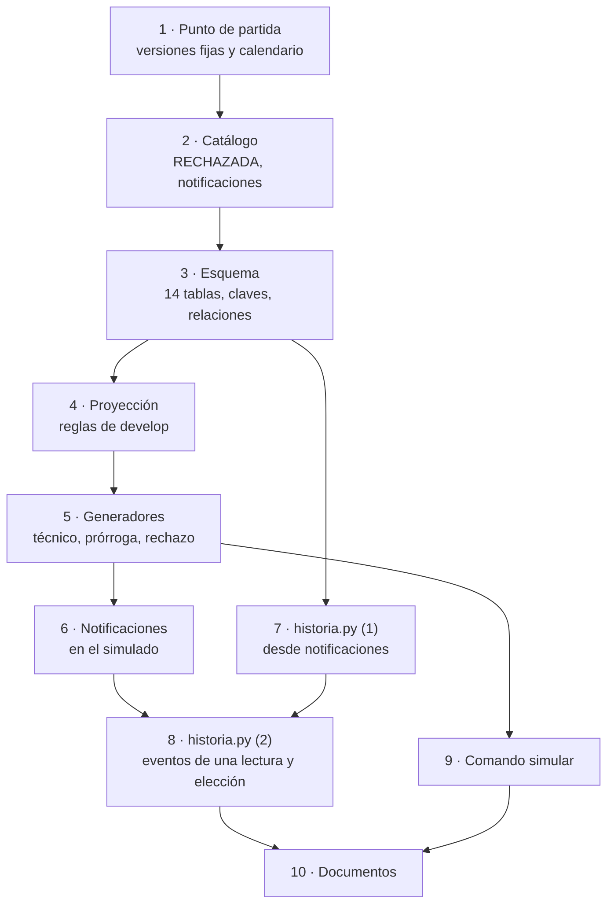
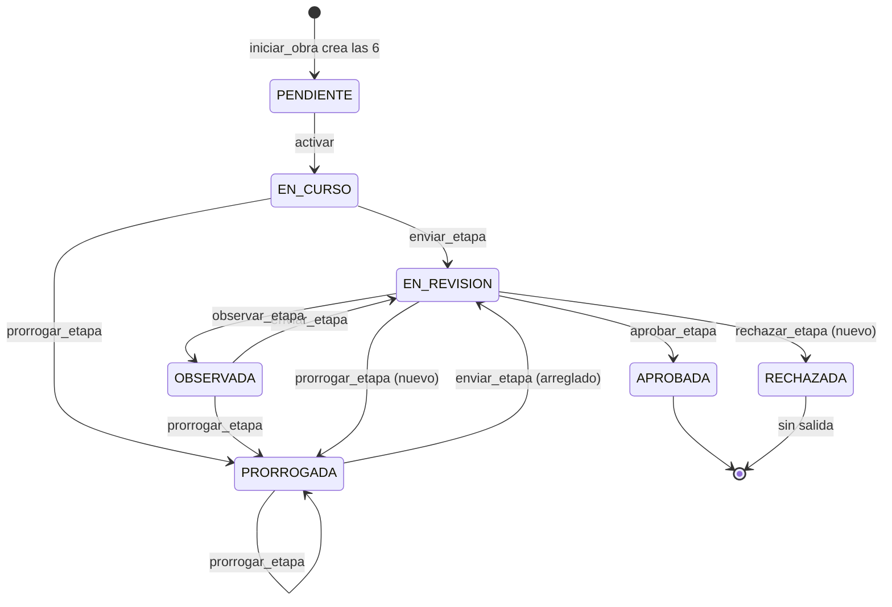
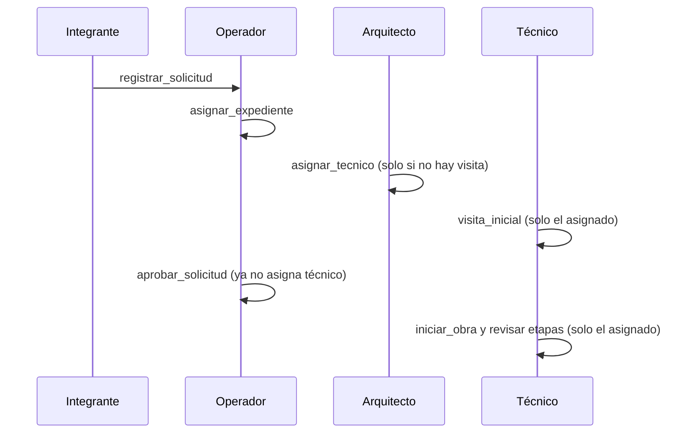
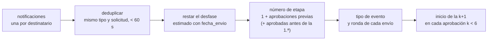
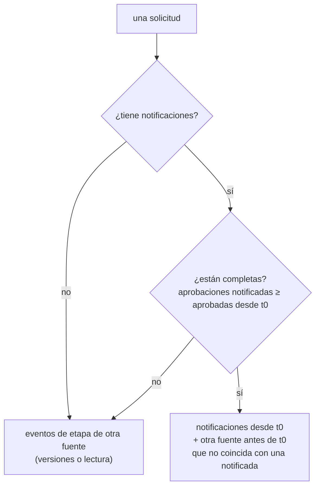

# Plan 1b · Realineación con `develop` y base común

> **HECHO el 04/11/2026** (commits `765c702` a `8a0b00a` en `main`; 174 pruebas en verde). Lo que cambió respecto de lo
> escrito abajo, para quien siga con los Planes 2 y 3:
>
> - **Historia (`analitica/historia.py`):** la primera notificación de cada obra se compara **truncada al minuto** contra
>   `fecha_revision` (que Java guarda truncada), al numerar las etapas y al decidir si una obra tiene notificaciones
>   incompletas. Hay una prueba para el caso «las notificaciones empiezan con una aprobación».
> - `eventos_de_notificaciones` devuelve los eventos **ordenados por momento y solicitud**.
> - El rechazo del simulador (`[E23]`) solo se sortea si su probabilidad es mayor que 0, así el mundo por defecto no
>   cambia. La prórroga desde `EN_REVISION` se acepta también en el modo del Java viejo (`[E10]` activado).
> - En las pruebas, el personal de `solicitud_aprobada()` (usuarios 5, 6 y 7) va **al final** de la lista.
> - El mundo simulado al 15/10/2026 con la semilla 8: 120 obras = 74 terminadas + 46 en curso, ninguna trabada, 2766
>   notificaciones.
> - **Pendientes chicos para el Plan 2:** endurecer `historia._coincide` si un evento de etapa llega sin `numero`
>   (`fillna(False)` al filtrar); recordar que la deduplicación une dos eventos iguales de la misma obra a menos de
>   60 segundos.

> **Para quien lo ejecuta (persona o agente):** seguí las tareas en orden y marcá cada casilla `- [ ]` al terminarla.
> Antes de empezar leé `../LEEME.md` (reglas del equipo) y las secciones de
> `../especificacion.md` que nombra cada tarea.

**Objetivo:** que el dominio, el esquema, el simulador y los documentos de `vivso-analitica` coincidan con el sistema
Java de hoy (rama `develop`, commit `5b36d7d`), y dejar escrita la base común que usan los Planes 2 y 3: la tabla 14
(`notificaciones`) y `analitica/historia.py`.

**Arquitectura:** se cambia lo que ya existe sin reestructurarlo: `catalogo.py`, `esquema.py`, `origenes/base.py`, la
proyección y los generadores del simulador. Se agrega un módulo nuevo y puro, `analitica/historia.py`, con el contrato
de eventos que comparten todos los planes siguientes.

**Tecnología:** Python 3.13, pandas, numpy, Faker, pytest (lo que ya usa el proyecto; este plan no agrega dependencias).

**Especificación:** `../especificacion.md`, decisiones 21 a 25 y secciones 3.2, 3.3, 3.4, 5.2, 5.3, 6.1 y 7.5.

**Depende de:** el Plan 1 (hecho). **Lo necesitan:** todos los demás planes. Conviene que lo haga una sola persona,
rápido (son 10 tareas chicas), mientras el resto lee la especificación y prepara su entorno.

## Restricciones globales

- Python 3.13 con el entorno `.venv` de la carpeta; los comandos son de PowerShell y se corren desde `vivso-analitica/`.
- Todo en español: nombres de funciones y variables, docstrings, mensajes de error, documentos y mensajes de commit.
- Ninguna prueba usa la red ni variables `ANALITICA_*` (lo garantiza `tests/conftest.py`; no lo toques).
- Nunca se leen columnas con `token`, `password`, `contrasena`, `clave`, `secret` o `hash` en el nombre; de `familia` y
  `familiar`, solo `id_familia`, la cantidad de familiares y `antiguedad_rancho`.
- Ningún dato real en el repositorio: el simulador inventa todo.
- Los documentos de `README.md` y `docs/*.md` no pueden nombrar los planes («Plan N») ni herramientas de IA, ni el host de Aiven
  (`tests/test_documentos.py` lo controla); llevan diagramas Mermaid compatibles con Mermaid 11 (GitHub).
- Commits en español, descriptivos, sin líneas de coautoría ni menciones a herramientas de IA.
- Antes de cada commit: `.venv\Scripts\python.exe -m pytest -q` con todo en verde.
- El núcleo (`analitica/`) no importa `fastapi` ni `streamlit`.

## Foco de revisión

Lo que ninguna tarea prueba directamente y más puede fallar:

1. **Reproducibilidad con la semilla 8:** cambiar el orden en que los generadores sacan números al azar cambia el mundo
   entero. Está bien que cambie, pero dos corridas iguales tienen que dar lo mismo (`test_cumple_el_contrato_y_es_reproducible`).
2. **Relaciones sin huérfanas en el simulado:** con las relaciones nuevas (notificaciones, revisores, técnico asignado),
   `verificar_relaciones` del mundo simulado tiene que seguir dando `[]`.
3. **Obras de la base de pruebas cargadas antes del 27/10** sin técnico asignado: la proyección tiene que rechazar su
   visita y su inicio de obra con un mensaje claro (`ReglaDeJava` que nombre «técnico asignado»).
4. **Notificaciones repetidas en el mismo segundo** para varios destinatarios: la historia cuenta un solo evento.
5. **Un mundo con `prob_rechazo_etapa = 1`**: ninguna acción posterior sobre esa obra (la proyección lanzaría
   `ReglaDeJava`), y el comando `simular` muestra la etapa como `(RECHAZADA)`.

## Mapa



Las etapas de obra como quedaron en `develop` (lo que tiene que respetar la proyección):



El técnico asignado, antes y ahora:



## Archivos

| Archivo | Qué cambia |
| :--- | :--- |
| `requirements.txt`, `requirements-dev.txt` | Versiones fijas |
| `analitica/calendario.py` | `es_habil` y `sumar_habiles` aceptan `datetime` |
| `analitica/catalogo.py` | `RECHAZADA`, `ESTADOS_FINALES`, `TIPOS_NOTIFICACION`, `TIPOS_ORGANIZACION` |
| `analitica/esquema.py` | `usuarios.nombre`, `usuarios.apellido`, tabla `notificaciones`, `CLAVES`, `clave_de` |
| `analitica/origenes/base.py` | Relaciones nuevas |
| `analitica/origenes/simulado_proyeccion.py` | Reglas de `develop`, `asignar_tecnico`, `rechazar_etapa`, notificaciones |
| `analitica/parametros_simulacion.py` | `[E10]` apagado, `[E19]` nuevo, `[E23]`, `[E24]` |
| `analitica/origenes/simulado_organizaciones.py`, `simulado_solicitudes.py`, `simulado_obras.py`, `simulado.py` | Generadores |
| `analitica/historia.py` (nuevo) | Contrato de eventos e historia de etapas |
| `analitica/__main__.py` | `simular` muestra rechazadas y notificaciones |
| `tests/test_*.py` | Pruebas nuevas y ajustes; `tests/test_historia.py` (nuevo) |
| `README.md`, `docs/*.md` | Documentos al día |

---

### Tarea 1: Punto de partida, versiones fijas y calendario con `datetime`

**Archivos:** `requirements.txt`, `requirements-dev.txt`, `analitica/calendario.py`, `tests/test_calendario.py`

**Interfaces:**
- Produce: `Calendario.es_habil(fecha: date | datetime) -> bool` y `Calendario.sumar_habiles(desde: date | datetime, n: int) -> date`
  (un `datetime` se pasa antes a su fecha en Buenos Aires, igual que ya hace `habiles_entre`).

- [x] **Paso 1:** comprobar el punto de partida: `.venv\Scripts\python.exe -m pytest -q` → `143 passed`. Si el
  repositorio todavía no tiene commits, hacer el primero ahora con todo lo que hay (ver `../LEEME.md`, «Paso 0»).
- [x] **Paso 2:** fijar versiones. `requirements.txt` pasa a `==` con las versiones con las que se desarrolló:
  `pandas==3.0.6`, `numpy==2.5.4`, `Faker==40.43.0`, `holidays==0.107`, `httpx==0.28.1`, `python-dotenv==1.2.4`,
  `tzdata==2026.5` (se conservan los comentarios de cada línea). `requirements-dev.txt`: `-r requirements.txt` y
  `pytest==9.1.1`.
- [x] **Paso 3: prueba que falla** en `tests/test_calendario.py`:

```python
def test_un_datetime_se_cuenta_por_su_fecha():
    feriado = date(2026, 10, 12)
    calendario = Calendario([feriado])
    assert calendario.es_habil(datetime(2026, 10, 12, 9, 30)) is False
    assert calendario.sumar_habiles(datetime(2026, 10, 9, 18, 0), 1) == date(2026, 10, 13)
```

- [x] **Paso 4:** correr `.venv\Scripts\python.exe -m pytest tests\test_calendario.py -q` → falla (hoy un `datetime`
  nunca coincide con un feriado `date` y `sumar_habiles` devuelve un `datetime`).
- [x] **Paso 5:** en `es_habil` y `sumar_habiles`, pasar el argumento por `_dia(...)` al principio.
- [x] **Paso 6:** correr la suite completa → todo en verde.
- [x] **Paso 7: commit** `git add requirements.txt requirements-dev.txt analitica/calendario.py tests/test_calendario.py`
  y `git commit -m "Fijar versiones y contar feriados también cuando el calendario recibe fecha y hora"`.

### Tarea 2: Catálogo al día con `develop`

**Archivos:** `analitica/catalogo.py`, `tests/test_catalogo.py`

**Interfaces:**
- Produce: `ESTADOS_ETAPA` (7 valores, `RECHAZADA` al final), `ESTADOS_ACTIVOS` (sin cambios),
  `ESTADOS_FINALES = ("APROBADA", "RECHAZADA")`, `TIPOS_NOTIFICACION` (tupla de 6) y `TIPOS_ORGANIZACION`
  (`dict[str, str]`, nombre del enum → descripción).

- [x] **Paso 1: pruebas que fallan** en `tests/test_catalogo.py` (ajustar `test_estados_y_roles_como_los_guarda_la_base`
  y agregar dos):

```python
def test_estados_y_roles_como_los_guarda_la_base():
    assert ESTADOS_ETAPA == ("PENDIENTE", "EN_CURSO", "EN_REVISION", "PRORROGADA", "OBSERVADA", "APROBADA", "RECHAZADA")
    assert ESTADOS_ACTIVOS == ("EN_CURSO", "EN_REVISION", "PRORROGADA", "OBSERVADA")
    assert ESTADOS_FINALES == ("APROBADA", "RECHAZADA")
    # (las aserciones que ya tenía la prueba sobre ESTADOS_SOLICITUD y ROLES se conservan)


def test_tipos_de_notificacion_como_los_escribe_etapa_obra_service():
    assert TIPOS_NOTIFICACION == ("ETAPA_HABILITADA", "ETAPA_ENVIADA", "ETAPA_APROBADA", "ETAPA_OBSERVADA",
                                  "ETAPA_PRORROGADA", "ETAPA_RECHAZADA")


def test_tipos_de_organizacion_de_java():
    assert TIPOS_ORGANIZACION == {
        "ASOCIACION_CIVIL": "Asociación Civil", "FUNDACION": "Fundación", "COOPERATIVA": "Cooperativa",
        "COMUNIDAD_INDIGENA": "Comunidad Indígena", "INSTITUCION_RELIGIOSA": "Institución Religiosa",
        "CLUB_SOCIAL_Y_DEPORTIVO": "Club Social y Deportivo", "MUTUAL": "Mutual", "OTRA": "Otra"}
    # Ninguno es OG: un municipio que elija «Otra» se clasifica por el nombre.
    assert grupo_organizacion("Otra", "Municipalidad de Quimilí").grupo == "OG"
    assert grupo_organizacion("Fundación", "Fundación Municipal").grupo == "ONG"
```

- [x] **Paso 2:** correr `tests\test_catalogo.py` → falla con `ImportError`.
- [x] **Paso 3:** agregar las constantes en `analitica/catalogo.py`, cada una con un comentario de una línea que nombre
  su fuente en Java (`EstadoEtapa.java`, `EtapaObraService.java`, `TipoOrganizacion.java`), y actualizar la fecha de
  revisión del docstring del módulo a «revisado el 04/11/2026 en la rama develop».
- [x] **Paso 4:** suite completa en verde.
- [x] **Paso 5: commit** `"Sumar el estado RECHAZADA, los tipos de notificación y los tipos de organización de Java"`.

### Tarea 3: Esquema de 14 tablas, claves y relaciones

**Archivos:** `analitica/esquema.py`, `analitica/origenes/base.py`, `analitica/origenes/vacio.py` (solo el docstring),
`tests/test_esquema.py`, `tests/test_simulado_proyeccion.py` (renombrar `test_sin_hechos_hay_trece_tablas_vacias`)

**Interfaces:**
- Produce: `COLUMNAS["usuarios"]` termina en `("nombre", "str"), ("apellido", "str")`; `COLUMNAS["notificaciones"] =
  (("id_notificacion", "int"), ("id_usuario", "int"), ("tipo", "str"), ("id_referencia", "int"), ("fecha", "datetime"),
  ("leida", "bool"))`, última tabla de `TABLAS`.
- Produce: `CLAVES: dict[str, tuple[str, ...]]` (sección 5.3 de la especificación) y
  `clave_de(tabla: str, fila: Mapping) -> str` (los valores de la clave unidos con `"|"`, con `str()`; un `int` de numpy
  se escribe sin decimales).
- Produce: `RELACIONES` suma, en este orden al final: `("solicitudes", "id_tecnico_asignado", "usuarios", "id_usuario")`,
  `("viviendas", "id_familia", "familias", "id_familia")`, `("visitas_obra", "id_tecnico", "usuarios", "id_usuario")`,
  `("solicitudes_organizacion", "id_revisor", "usuarios", "id_usuario")`, `("documentos", "cuit_org", "organizaciones",
  "cuit")`, `("documentos", "id_revisor", "usuarios", "id_usuario")`, `("notificaciones", "id_usuario", "usuarios",
  "id_usuario")`, `("notificaciones", "id_referencia", "solicitudes", "id_solicitud")`.

- [x] **Paso 1: pruebas que fallan** en `tests/test_esquema.py`:

```python
def test_las_14_tablas_en_orden():          # reemplaza a test_las_13_tablas_en_orden
    assert TABLAS == ("solicitudes", "familias", "viviendas", "etapas", "fotos_etapa", "visitas_iniciales",
                      "fotos_visita", "visitas_obra", "organizaciones", "solicitudes_organizacion", "integrantes",
                      "usuarios", "documentos", "notificaciones")
    assert nombres("usuarios")[-2:] == ["nombre", "apellido"]
    assert nombres("notificaciones") == ["id_notificacion", "id_usuario", "tipo", "id_referencia", "fecha", "leida"]


def test_las_columnas_nuevas_de_usuario_que_nunca_se_leen():
    assert columnas_prohibidas(["push_token", "debe_cambiar_password", "nombre"]) == ["push_token", "debe_cambiar_password"]


def test_cada_tabla_tiene_su_clave():
    assert set(CLAVES) == set(TABLAS)
    assert all(set(CLAVES[t]) <= set(nombres(t)) for t in TABLAS)
    assert clave_de("fotos_visita", {"id_visita": np.int64(3), "url_foto": "u/1.jpg"}) == "3|u/1.jpg"
    assert clave_de("organizaciones", {"cuit": "30-1-1"}) == "30-1-1"


def test_relaciones_de_las_notificaciones():
    lectura = Lectura("simulado", datetime(2026, 11, 4), {t: tabla_vacia(t) for t in TABLAS})
    lectura.tablas["notificaciones"] = armar_tabla("notificaciones", [
        {"id_notificacion": 1, "id_usuario": 7, "tipo": "ETAPA_ENVIADA", "id_referencia": 3,
         "fecha": datetime(2026, 11, 3, 10), "leida": False}])
    assert verificar_relaciones(lectura) == [
        "notificaciones.id_usuario: 1 filas con un valor que no está en usuarios.id_usuario",
        "notificaciones.id_referencia: 1 filas con un valor que no está en solicitudes.id_solicitud"]
```

  (Ajustar también la prueba existente de `armar_tabla`/origen vacío si cuenta 13 tablas.)
- [x] **Paso 2:** correr `tests\test_esquema.py` → falla.
- [x] **Paso 3:** implementar en `esquema.py` y `base.py`. Actualizar el docstring de `esquema.py` («Las 14 tablas…»)
  y el de `vacio.py`. Renombrar `test_sin_hechos_hay_trece_tablas_vacias` a `test_sin_hechos_hay_catorce_tablas_vacias`
  (su aserción ya usa `TABLAS`). Para que la proyección siga funcionando, en `_Proyeccion.__init__` no hace falta nada:
  ya arma un diccionario por cada tabla de `TABLAS`.
- [x] **Paso 4:** suite completa. Lo que falle por contar 13 tablas se ajusta a 14; `test_los_supuestos_a_la_fecha_de_referencia`
  tiene que seguir con `verificar_relaciones(lectura) == []` (si no, hay una relación mal escrita o un generador que deja
  un id inexistente: corregir el generador, no la relación).
- [x] **Paso 5: commit** `"Sumar la tabla de notificaciones, el nombre y apellido de usuarios, las claves y relaciones nuevas"`.

### Tarea 4: Proyección con las reglas de `develop`

**Archivos:** `analitica/origenes/simulado_proyeccion.py`, `tests/test_simulado_proyeccion.py`

**Interfaces:**
- Consume: `TIPOS_NOTIFICACION` (Tarea 2), tabla `notificaciones` (Tarea 3).
- Produce: `proyectar(hechos, corte, *, error_prorroga_java: bool = False, desfase_notificaciones_horas: int = 0)`
  (el valor por defecto de `error_prorroga_java` pasa a `False`).
- Produce: acciones nuevas en `ACCIONES`: `"asignar_tecnico"` (datos: `id_solicitud`, `id_tecnico`) y
  `"rechazar_etapa"` (datos: `id_etapa_obra`, `motivo`). `crear_usuario` acepta además `nombre` y `apellido` (opcionales).

Reglas (cada una replica un método de `develop`; si no se cumple, `ReglaDeJava` con un mensaje que nombre la acción):

| Acción | Precondición | Efecto |
| :--- | :--- | :--- |
| `asignar_tecnico` | el autor tiene rol `ARQUITECTO` o `ADMIN`; el usuario `id_tecnico` existe y tiene rol `TECNICO`; la solicitud no tiene visita inicial | `id_tecnico_asignado = id_tecnico` (se puede reasignar antes de la visita) |
| `visita_inicial` | además de lo actual: el autor es el técnico asignado | sin cambios |
| `aprobar_solicitud` | sin cambios | **ya no** toca `id_tecnico_asignado` |
| `subir_foto` | `EN_CURSO`, `OBSERVADA` o `PRORROGADA` (con `error_prorroga_java=True`, solo las dos primeras, como el Java viejo) | sin cambios |
| `borrar_foto` | `EN_CURSO` u `OBSERVADA` | sin cambios |
| `prorrogar_etapa` | `EN_CURSO`, `OBSERVADA`, `EN_REVISION` o `PRORROGADA`; técnico asignado; fecha hábil y posterior | sin cambios |
| `rechazar_etapa` | `EN_REVISION`; técnico asignado | `estado = "RECHAZADA"`, `observacion_tecnico = motivo`, `fecha_revision` al minuto, `id_revisor = autor` |

Notificaciones (una fila por destinatario, `id_notificacion` correlativo desde 1 en el orden en que se aplican los
hechos, `fecha = momento_registrado + desfase_notificaciones_horas` horas, `leida = False`, `id_referencia` = la
solicitud): `iniciar_obra` → `ETAPA_HABILITADA`; `aprobar_etapa` → `ETAPA_APROBADA`; `observar_etapa` →
`ETAPA_OBSERVADA`; `prorrogar_etapa` → `ETAPA_PRORROGADA`; `rechazar_etapa` → `ETAPA_RECHAZADA`, todas a cada
integrante **activo con `id_usuario`** de la organización de la solicitud, en orden de `id_integrante`; `enviar_etapa`
→ `ETAPA_ENVIADA` al técnico asignado (si no hay, ninguna).

- [x] **Paso 1:** actualizar la ayuda `solicitud_aprobada()` de `tests/test_simulado_proyeccion.py`: agrega al
  principio `h("crear_usuario", cuando - timedelta(days=1), None, id_usuario=5, username="tec.uno", rol="TECNICO",
  email="tec.uno@example.com", nombre="Tec", apellido="Uno")`, lo mismo para `id_usuario=6` (`TECNICO`, `tec.dos`,
  `tec.dos@example.com`) y `id_usuario=7` (`ARQUITECTO`, `arq.uno`, `arq.uno@example.com`), un minuto después cada uno,
  y después de `asignar_expediente` el hecho `h("asignar_tecnico", cuando + timedelta(days=2, hours=1), 7,
  id_solicitud=1, id_tecnico=5)`; `aprobar_solicitud` queda sin `id_tecnico_asignado`. Ajustar
  `test_solo_el_tecnico_asignado_inicia_la_obra` para que el caso «sin técnico» saque el hecho `asignar_tecnico` en vez
  de pasar `id_tecnico_asignado=None`. Agregar al archivo `BASE = VIERNES - timedelta(days=30)` (el `cuando` por defecto
  de la ayuda) y la ayuda `visita(cuando, autor)`, que arma el hecho `visita_inicial` de la solicitud 1 con
  `id_visita=1, clasificacion="TIPO_1A", observaciones="x", habitantes=3, prioridad_social=False, fotos=[],
  departamento="Capital", localidad="Santiago del Estero", latitud=-27.8, longitud=-64.26`.
- [x] **Paso 2: pruebas que fallan** (en el mismo archivo; la asignación es en `BASE + 2 días 1 hora` y la aprobación
  en `BASE + 3 días`):

```python
def test_el_arquitecto_asigna_un_tecnico_antes_de_la_visita():
    filas = proyectar(solicitud_aprobada(), FIN)
    assert filas["solicitudes"][0]["id_tecnico_asignado"] == 5
    reasignar = h("asignar_tecnico", BASE + timedelta(days=2, hours=13), 7, id_solicitud=1, id_tecnico=6)
    with pytest.raises(ReglaDeJava, match="visita"):
        proyectar(solicitud_aprobada() + [visita(BASE + timedelta(days=2, hours=12), 5), reasignar], FIN)


@pytest.mark.parametrize("autor, tecnico, problema", [(5, 6, "ARQUITECTO"), (7, 7, "TECNICO")])
def test_quien_asigna_y_a_quien(autor, tecnico, problema):
    hechos = [x for x in solicitud_aprobada() if x.accion != "asignar_tecnico"]
    with pytest.raises(ReglaDeJava, match=problema):
        proyectar(hechos + [h("asignar_tecnico", BASE + timedelta(days=2, hours=1), autor, id_solicitud=1,
                              id_tecnico=tecnico)], FIN)


def test_la_visita_inicial_la_hace_el_tecnico_asignado():
    with pytest.raises(ReglaDeJava, match="técnico asignado"):
        proyectar(solicitud_aprobada() + [visita(BASE + timedelta(days=2, hours=12), 6)], FIN)


def test_una_etapa_prorrogada_se_envia_y_acepta_fotos():
    martes = datetime(2026, 10, 20, 17, 0)
    hechos = obra(h("prorrogar_etapa", martes, 5, id_etapa_obra=1, fecha_limite=date(2026, 10, 23), motivo="lluvias"),
                  foto(martes + timedelta(days=1)),
                  h("enviar_etapa", martes + timedelta(days=2), 11, id_etapa_obra=1, observacion_organizacion=None))
    filas = proyectar(hechos, FIN)
    assert etapas(filas)[0]["estado"] == "EN_REVISION" and len(filas["fotos_etapa"]) == 1
    with pytest.raises(ReglaDeJava, match="PRORROGADA"):
        proyectar(hechos, FIN, error_prorroga_java=True)


def test_se_prorroga_una_etapa_en_revision():
    lunes = datetime(2026, 10, 19, 9, 0)
    e1 = etapas(proyectar(obra(
        h("enviar_etapa", lunes, 11, id_etapa_obra=1, observacion_organizacion=None),
        h("prorrogar_etapa", lunes + timedelta(hours=2), 5, id_etapa_obra=1, fecha_limite=date(2026, 10, 23), motivo="x"),
    ), FIN))[0]
    assert (e1["estado"], e1["fecha_limite"]) == ("PRORROGADA", date(2026, 10, 23))


def test_rechazar_una_etapa_la_deja_sin_salida():
    lunes = datetime(2026, 10, 19, 9, 0)
    rechazo = [h("enviar_etapa", lunes, 11, id_etapa_obra=1, observacion_organizacion=None),
               h("rechazar_etapa", lunes + timedelta(hours=2, seconds=40), 5, id_etapa_obra=1, motivo="no respeta los planos")]
    e1 = etapas(proyectar(obra(*rechazo), FIN))[0]
    assert (e1["estado"], e1["observacion_tecnico"], e1["fecha_revision"], e1["id_revisor"]) == (
        "RECHAZADA", "no respeta los planos", datetime(2026, 10, 19, 11, 0), 5)
    for despues in (h("enviar_etapa", lunes + timedelta(days=1), 11, id_etapa_obra=1, observacion_organizacion=None),
                    h("prorrogar_etapa", lunes + timedelta(days=1), 5, id_etapa_obra=1, fecha_limite=date(2026, 10, 30), motivo="x")):
        with pytest.raises(ReglaDeJava, match="RECHAZADA"):
            proyectar(obra(*rechazo, despues), FIN)


def test_las_notificaciones_como_en_java():
    lunes = datetime(2026, 10, 19, 9, 0, 30)
    filas = proyectar(obra(
        h("enviar_etapa", lunes, 11, id_etapa_obra=1, observacion_organizacion=None),
        h("aprobar_etapa", lunes + timedelta(hours=1), 5, id_etapa_obra=1),
    ), FIN, desfase_notificaciones_horas=3)
    notificaciones = [(n["id_notificacion"], n["id_usuario"], n["tipo"], n["id_referencia"], n["fecha"], n["leida"])
                      for n in filas["notificaciones"]]
    assert notificaciones == [
        (1, 11, "ETAPA_HABILITADA", 1, VIERNES + timedelta(hours=3), False),
        (2, 12, "ETAPA_HABILITADA", 1, VIERNES + timedelta(hours=3), False),
        (3, 5, "ETAPA_ENVIADA", 1, lunes + timedelta(hours=3), False),
        (4, 11, "ETAPA_APROBADA", 1, lunes + timedelta(hours=4), False),
        (5, 12, "ETAPA_APROBADA", 1, lunes + timedelta(hours=4), False),
    ]
```

  (En `obra()`, los usuarios 11 y 12 son el presidente y el tesorero que crea `aprobar_alta`, activos y con usuario.)
- [x] **Paso 3:** correr `tests\test_simulado_proyeccion.py` → fallan las nuevas.
- [x] **Paso 4:** implementar. Ayudas privadas sugeridas: `_rol(id_usuario) -> str | None`,
  `_usuarios_de_la_organizacion(cuit) -> list[int]`, `_notificar(h, id_solicitud, tipo, destinatarios)`. Las
  notificaciones se agregan con `_nueva("notificaciones", id, ...)`. Borrar `test_una_etapa_prorrogada_queda_trabada_por_el_error_de_java`
  (lo reemplaza `test_una_etapa_prorrogada_se_envia_y_acepta_fotos`, que también prueba el modo viejo).
- [x] **Paso 5:** suite completa. Fallarán pruebas de los generadores (todavía no emiten `asignar_tecnico`): es
  esperado y se arregla en la Tarea 5. **No commitear todavía**: esta tarea y la 5 van en el mismo commit.

### Tarea 5: Generadores del simulador (`[E2]`, `[E7]`, `[E10]`, `[E19]`, `[E23]`, `[E24]`)

**Archivos:** `analitica/parametros_simulacion.py`, `analitica/origenes/simulado_organizaciones.py`,
`analitica/origenes/simulado_solicitudes.py`, `analitica/origenes/simulado_obras.py`, `analitica/origenes/simulado.py`,
`tests/test_simulado_organizaciones.py`, `tests/test_simulado_solicitudes.py`, `tests/test_simulado_obras.py`

**Interfaces:**
- Produce en `ParametrosSimulacion`: `error_prorroga_java: bool = False` (`[E10]`), `asignar_tecnico: bool = True`,
  `asignacion_tecnico_dias: tuple[int, int] = (1, 10)`, `prob_tecnico_sin_visita: float = 0.5` (`[E19]`),
  `prob_rechazo_etapa: float = 0.0` (`[E23]`), `desfase_notificaciones_horas: int = 0` (`[E24]`).
- Produce: `MOTIVOS_RECHAZO_ETAPA = ("La obra no respeta los planos del prototipo", "Se usaron materiales distintos de
  los aprobados", "Las fotos no corresponden a la vivienda")` en `parametros_simulacion.py`.
- `OrigenSimulado.leer_al` pasa `desfase_notificaciones_horas=self.parametros.desfase_notificaciones_horas` a `proyectar`.

Comportamiento:

- **Personal (`[E3]`)**: `crear_usuario` lleva `nombre` y `apellido` de la persona inventada. Los usuarios de
  integrantes (los que crea `aprobar_alta`) quedan sin nombre ni apellido, como en Java.
- **Organizaciones (`[E2]`)**: las ONG usan las descripciones de Java («Asociación Civil» o «Cooperativa», con el
  nombre como hoy); las OG usan tipo «Otra» con nombre «Municipalidad de …» o «Comisión Municipal de …» (Java no tiene
  un tipo para ellas). `OrganizacionSimulada.grupo` no cambia.
- **Técnico (`[E19]`)**: por cada solicitud con visita, el arquitecto (`orgs.arquitectos[0]`) emite `asignar_tecnico`
  en un día hábil entre `registro + asignacion_tecnico_dias[0]` y `min(registro + asignacion_tecnico_dias[1],
  visita − 1 día)`, siempre después del registro y antes de la visita (si el rango queda vacío, una hora antes de la
  visita). La visita la registra ese técnico. Las solicitudes «pendiente» (sin visita) reciben técnico con probabilidad
  `prob_tecnico_sin_visita`. Con `asignar_tecnico=False`, cada solicitud emite solo `registrar_solicitud` y
  `asignar_expediente`: ninguna llega a visita ni a obra. `ObraPorIniciar.tecnico` es el técnico asignado.
- **Prórroga (`[E7]` y `[E10]`)**: con `error_prorroga_java=False`, las fotos de la ronda posteriores a la prórroga se
  suben igual (Java las acepta en `PRORROGADA`); un borrado posterior a la prórroga se descarta (Java no lo acepta); el
  envío sigue como siempre. Con `True`, el comportamiento de hoy (la etapa queda trabada).
- **Rechazo (`[E23]`)**: en cada revisión, antes de decidir entre observar y aprobar, con probabilidad
  `prob_rechazo_etapa` el técnico emite `rechazar_etapa` con un motivo de `MOTIVOS_RECHAZO_ETAPA` y la obra termina ahí
  (`etapa()` devuelve `None`). El avance físico de esa etapa termina en su envío real, como hoy.

- [x] **Paso 1: pruebas que fallan**:

```python
# tests/test_simulado_solicitudes.py (reemplaza test_sin_la_vista_del_arquitecto_no_hay_tecnico_asignado y la última
# aserción de test_la_proyeccion_no_viola_reglas_de_java)
def test_el_tecnico_se_asigna_antes_de_la_visita_y_la_hace_el(sols):
    asignacion = {x.datos["id_solicitud"]: x for x in sols.hechos if x.accion == "asignar_tecnico"}
    visitas = [x for x in sols.hechos if x.accion == "visita_inicial"]
    assert visitas
    for visita in visitas:
        asignada = asignacion[visita.datos["id_solicitud"]]
        assert asignada.momento_registrado < visita.momento_registrado
        assert visita.autor == asignada.datos["id_tecnico"]
    registros = momentos(sols, "registrar_solicitud")
    assert all(registros[s] < x.momento_registrado for s, x in asignacion.items())


def test_sin_la_vista_del_arquitecto_nada_pasa_de_pendiente():
    orgs, sols = generar(replace(PARAMETROS, asignar_tecnico=False))
    con_ids, _ = asignar_ids(orgs.hechos + sols.hechos)
    filas = proyectar(con_ids, FIN)
    assert {s["estado"] for s in filas["solicitudes"]} == {"Pendiente"}
    assert filas["visitas_iniciales"] == [] and sols.obras == []

# tests/test_simulado_obras.py
def test_sin_el_error_de_java_las_prorrogadas_se_envian():
    filas, _ = proyectar_mundo(*mundo_con(prob_prorroga=1.0, duracion_mediana=3.0))
    obras = por_obra(filas)
    assert not [e for e in filas["etapas"] if e["estado"] == "PRORROGADA"]
    assert all(etapas[-1]["estado"] == "APROBADA" for etapas in obras.values())
    assert any(e["fecha_limite"] != e["fecha_limite_original"] for e in filas["etapas"])


def test_con_el_error_de_java_las_prorrogadas_quedan_trabadas():
    filas, _ = proyectar_mundo(*mundo_con(prob_prorroga=1.0, duracion_mediana=3.0, error_prorroga_java=True),
                               error_prorroga_java=True)
    # (mismo cuerpo de antes: cada etapa con límite cambiado está PRORROGADA y las posteriores sin empezar)


def test_con_rechazo_la_obra_se_detiene():
    filas, _ = proyectar_mundo(*mundo_con(prob_rechazo_etapa=1.0))
    for etapas in por_obra(filas).values():
        assert etapas[0]["estado"] == "RECHAZADA"
        assert all(e["estado"] == "PENDIENTE" for e in etapas[1:])
```

  `proyectar_mundo` pasa a tener `error_prorroga_java=False` por defecto. En `tests/test_simulado_organizaciones.py`
  agregar que todos los usuarios de rol distinto de `INTEGRANTE` tienen `nombre` y `apellido`, que los de `INTEGRANTE`
  no los tienen, y que los tipos de las altas están en `{"Asociación Civil", "Cooperativa", "Otra"}` con «Otra»
  presente.
- [x] **Paso 2:** correr los tres archivos → fallan.
- [x] **Paso 3:** implementar. En `simulado_solicitudes.py`, `_Plan` suma `tecnico: datetime | None` (el momento de la
  asignación) y `emitir()` decide el técnico con `self.elegir(self.orgs.tecnicos)` antes de emitir la asignación; los
  momentos van con `self.momento(self.dia_entre(...))` como el resto.
- [x] **Paso 4:** suite completa en verde. `test_los_supuestos_a_la_fecha_de_referencia` sigue valiendo (120 obras, 12
  organizaciones, 24 integrantes con usuario, sin huérfanas).
- [x] **Paso 5: commit** (Tareas 4 y 5 juntas)
  `"Aplicar las reglas de la rama develop: técnico asignado por el arquitecto, envío de etapas prorrogadas, rechazo y notificaciones"`.

### Tarea 6: Notificaciones en el origen simulado

**Archivos:** `tests/test_simulado.py`

**Interfaces:** consume todo lo anterior; no produce código nuevo (si una prueba falla, el arreglo va en la proyección o
en los generadores).

- [x] **Paso 1: pruebas** en `tests/test_simulado.py`:

```python
def test_las_notificaciones_del_mundo_simulado(origen, lectura):
    hechos = [x for x in origen.verdad() if x.momento_registrado <= lectura.leido_en]
    cuenta = Counter(x.accion for x in hechos)
    a_la_organizacion = sum(cuenta[a] for a in ("iniciar_obra", "aprobar_etapa", "observar_etapa",
                                               "prorrogar_etapa", "rechazar_etapa"))
    notificaciones = lectura.tabla("notificaciones")
    assert len(notificaciones) == 2 * a_la_organizacion + cuenta["enviar_etapa"]
    assert set(notificaciones["tipo"]) <= set(TIPOS_NOTIFICACION)
    assert not notificaciones["leida"].any()


def test_el_desfase_de_las_notificaciones():
    corrido = OrigenSimulado(8, hasta=REF, parametros=replace(PARAMETROS, desfase_notificaciones_horas=3)).leer()
    normal = OrigenSimulado(8, hasta=REF).leer()
    diferencia = corrido.tabla("notificaciones")["fecha"] - normal.tabla("notificaciones")["fecha"]
    assert (diferencia == pd.Timedelta(hours=3)).all()
```

  Ojo: con desfase 3, las notificaciones de las 3 últimas horas antes del corte siguen estando (se registran por la
  hora del hecho, no por la de la notificación). Si la segunda prueba falla por cantidad de filas, revisar eso.
- [x] **Paso 2:** correr; si algo falla, corregir la proyección o los generadores.
- [x] **Paso 3: commit** `"Probar las notificaciones del mundo simulado"`.

### Tarea 7: `historia.py`, primera parte: contrato y eventos desde las notificaciones

**Archivos:** `analitica/historia.py` (nuevo), `tests/test_historia.py` (nuevo)

**Interfaces (las usan los Planes 2, 3 y 4; no cambiar nombres sin avisar al equipo):**
- `COLUMNAS_EVENTOS = ("entidad", "clave", "id_solicitud", "numero", "tipo", "ronda", "momento", "precision", "fuente", "detalle")`
- `TIPOS_EVENTO_ETAPA = ("inicio", "envio", "observacion", "aprobacion", "prorroga", "rechazo")`
- `PRECISIONES = ("exacto", "dia", "intervalo")`; `FUENTES = ("notificaciones", "versiones", "lectura")`
- `TIPO_POR_NOTIFICACION = {"ETAPA_HABILITADA": "inicio", "ETAPA_ENVIADA": "envio", "ETAPA_APROBADA": "aprobacion",
  "ETAPA_OBSERVADA": "observacion", "ETAPA_PRORROGADA": "prorroga", "ETAPA_RECHAZADA": "rechazo"}`
- `tabla_eventos(filas: Iterable[Mapping]) -> pd.DataFrame`: las columnas de `COLUMNAS_EVENTOS` en orden, con tipos
  `entidad`, `clave`, `tipo`, `precision`, `fuente` → `string`; `id_solicitud`, `numero`, `ronda` → `Int64`;
  `momento` → `datetime64[ns]`; `detalle` → `object` (un `dict`, `{}` si falta). Sin filas, la tabla vacía con esos tipos.
- `deduplicar_notificaciones(notificaciones: pd.DataFrame, ventana_segundos: int = 60) -> pd.DataFrame`: una fila por
  evento (la más temprana), ordenada por `fecha`.
- `estimar_desfase_horas(lectura: Lectura) -> int`
- `eventos_de_notificaciones(lectura: Lectura, desfase_horas: int | None = None) -> pd.DataFrame` (con `None`, estima).

Reglas (especificación 7.5, puntos 1 a 4):



- `clave` = `str(id_etapa_obra)` de la etapa `numero` de esa solicitud según la tabla `etapas` (vacía si no está).
- `entidad = "etapas"`, `precision = "exacto"`, `fuente = "notificaciones"`, `detalle = {}` (el `inicio` derivado de
  una aprobación lleva `{"derivado_de": "aprobacion"}`).
- Desfase: por cada etapa con `fecha_envio`, la diferencia entre el **último** `envio` deduplicado de esa etapa y su
  `fecha_envio`, en horas, redondeada al entero más cercano; la mediana redondeada, si está entre −12 y 12; si no hay
  pares, `0`.

- [x] **Paso 1: pruebas que fallan** en `tests/test_historia.py`. Escenario armado a mano (una obra, solicitud 1,
  etapas 1 a 6 con ids 1 a 6; la 1 `APROBADA` con `fecha_envio=2026-10-19 15:00` y `fecha_revision=2026-10-20 11:30`;
  la 2 `EN_REVISION` con `fecha_inicio=2026-10-20` y `fecha_envio=2026-10-21 16:10`; el resto `PENDIENTE`). Notificaciones:

| id | usuario | tipo | fecha |
| ---: | ---: | :--- | :--- |
| 1 | 11 | ETAPA_HABILITADA | 2026-10-16 10:15:42 |
| 2 | 12 | ETAPA_HABILITADA | 2026-10-16 10:15:42 |
| 3 | 5 | ETAPA_ENVIADA | 2026-10-19 09:05:30 |
| 4 | 11 | ETAPA_OBSERVADA | 2026-10-19 12:00:10 |
| 5 | 12 | ETAPA_OBSERVADA | 2026-10-19 12:00:11 |
| 6 | 5 | ETAPA_ENVIADA | 2026-10-19 15:00:20 |
| 7 | 11 | ETAPA_APROBADA | 2026-10-20 11:30:59 |
| 8 | 12 | ETAPA_APROBADA | 2026-10-20 11:30:59 |
| 9 | 5 | ETAPA_ENVIADA | 2026-10-21 16:10:00 |

```python
ESPERADOS = [  # (numero, tipo, ronda, momento)
    (1, "inicio", None, datetime(2026, 10, 16, 10, 15, 42)),
    (1, "envio", 1, datetime(2026, 10, 19, 9, 5, 30)),
    (1, "observacion", None, datetime(2026, 10, 19, 12, 0, 10)),
    (1, "envio", 2, datetime(2026, 10, 19, 15, 0, 20)),
    (1, "aprobacion", None, datetime(2026, 10, 20, 11, 30, 59)),
    (2, "inicio", None, datetime(2026, 10, 20, 11, 30, 59)),
    (2, "envio", 1, datetime(2026, 10, 21, 16, 10, 0)),
]

def test_eventos_desde_notificaciones(lectura_con_notificaciones):
    eventos = eventos_de_notificaciones(lectura_con_notificaciones)
    assert list(eventos.columns) == list(COLUMNAS_EVENTOS)
    obtenidos = [(int(e.numero), e.tipo, None if pd.isna(e.ronda) else int(e.ronda), e.momento.to_pydatetime())
                 for e in eventos.itertuples()]
    assert obtenidos == ESPERADOS
    assert set(eventos["fuente"]) == {"notificaciones"} and set(eventos["precision"]) == {"exacto"}
    assert list(eventos["clave"]) == ["1", "1", "1", "1", "1", "2", "2"]


def test_el_desfase_se_estima_y_se_corrige(lectura_con_notificaciones):
    assert estimar_desfase_horas(lectura_con_notificaciones) == 0
    corrida = con_fechas_corridas(lectura_con_notificaciones, horas=3)   # ayuda del archivo de pruebas
    assert estimar_desfase_horas(corrida) == 3
    assert eventos_de_notificaciones(corrida)["momento"].tolist() == eventos_de_notificaciones(
        lectura_con_notificaciones)["momento"].tolist()


def test_notificaciones_que_empiezan_con_la_obra_avanzada():
    # Solicitud 2: etapas 1 y 2 APROBADA (fecha_revision 2026-10-01 y 2026-10-05), etapa 3 EN_REVISION;
    # una sola notificación: ETAPA_ENVIADA el 2026-11-04 10:00.
    eventos = eventos_de_notificaciones(lectura_obra_avanzada())
    assert [(int(e.numero), e.tipo) for e in eventos.itertuples()] == [(3, "envio")]


def test_sin_notificaciones_no_hay_eventos():
    assert eventos_de_notificaciones(lectura_vacia()).empty
    assert estimar_desfase_horas(lectura_vacia()) == 0


def test_contra_la_verdad_del_simulador():
    origen = OrigenSimulado(8, hasta=date(2026, 10, 15))
    lectura = origen.leer()
    eventos = eventos_de_notificaciones(lectura)
    numero = dict(zip(lectura.tabla("etapas")["id_etapa_obra"], lectura.tabla("etapas")["numero"]))
    por_accion = {"enviar_etapa": "envio", "aprobar_etapa": "aprobacion", "observar_etapa": "observacion",
                  "prorrogar_etapa": "prorroga", "rechazar_etapa": "rechazo"}
    esperados = sorted((numero[x.datos["id_etapa_obra"]], por_accion[x.accion], x.momento_registrado)
                       for x in origen.verdad() if x.accion in por_accion and x.momento_registrado <= lectura.leido_en)
    obtenidos = sorted((int(e.numero), e.tipo, e.momento.to_pydatetime())
                       for e in eventos.itertuples() if e.tipo != "inicio")
    assert obtenidos == esperados
```

  Las ayudas `lectura_con_notificaciones` (fixture), `con_fechas_corridas`, `lectura_obra_avanzada` y `lectura_vacia`
  se escriben en el mismo archivo con `armar_tabla` y `tabla_vacia`.
- [x] **Paso 2:** correr `tests\test_historia.py` → falla con `ImportError`.
- [x] **Paso 3:** implementar `analitica/historia.py` (docstring del módulo: qué es la historia de etapas y por qué
  sale de las notificaciones, en dos o tres oraciones). Sin `fastapi` ni `streamlit`.
- [x] **Paso 4:** suite completa en verde.
- [x] **Paso 5: commit** `"Reconstruir la historia de etapas desde las notificaciones de Java"`.

### Tarea 8: `historia.py`, segunda parte: eventos de una lectura y elección de la historia

**Archivos:** `analitica/historia.py`, `tests/test_historia.py`

**Interfaces:**
- `Vinculos` (dataclass) y `vinculos(lectura: Lectura) -> Vinculos`: los mapas `etapa_a_solicitud`,
  `vivienda_a_solicitud`, `familia_a_solicitud`, `visita_a_solicitud` (`dict[int, int]`) y
  `Vinculos.id_solicitud(entidad: str, fila: Mapping) -> int | None` (solicitudes → la propia; viviendas, etapas,
  visitas_iniciales → su `id_solicitud`; fotos_etapa → por su etapa; fotos_visita → por su visita; visitas_obra → por su
  vivienda; familias y documentos → por `id_familia`; notificaciones → `id_referencia`; el resto → `None`). La usan
  `eventos_de_la_lectura` y el sincronizador del Plan 2.
- `eventos_de_la_lectura(lectura: Lectura) -> pd.DataFrame` (contrato `COLUMNAS_EVENTOS`, `fuente = "lectura"`).
- `obras_con_notificaciones_incompletas(de_notificaciones: pd.DataFrame, etapas: pd.DataFrame) -> set[int]`
- `elegir_historia_de_etapas(de_notificaciones: pd.DataFrame, otros: pd.DataFrame, etapas: pd.DataFrame) -> pd.DataFrame`
- `eventos_para_contexto(lectura: Lectura, eventos_guardados: pd.DataFrame | None = None, desfase_horas: int | None = None) -> pd.DataFrame`
  (lo que usan los indicadores y la API: `otros` = `eventos_guardados` si se pasan —los del Plan 2— o
  `eventos_de_la_lectura(lectura)`; ordenado por `momento`, `id_solicitud`, `entidad`, `tipo`).

Qué fecha `eventos_de_la_lectura` (especificación 7.5, punto 6):

| Entidad | Evento | Momento | Precisión | `id_solicitud` |
| :--- | :--- | :--- | :--- | :--- |
| `solicitudes` | `solicitud_registrada`; `solicitud_aprobada` si hay `fecha_activacion` | la fecha a las 00:00 | `dia` | la propia |
| `viviendas` | `vivienda_creada` | `fecha_activacion` de su solicitud | `dia` | su solicitud |
| `visitas_iniciales` | `visita_inicial` | `fecha_visita` | `exacto` | su solicitud |
| `etapas` | `inicio` (si hay `fecha_inicio`), `envio` (último; `ronda` vacía), `aprobacion`/`rechazo`/`observacion` según el estado si hay `fecha_revision`; `prorroga` neta si `fecha_limite ≠ fecha_limite_original` | `fecha_inicio` a las 00:00 (`dia`); `fecha_envio`, `fecha_revision` (`exacto`); la prórroga en `leido_en` con `precision="intervalo"` y `detalle = {"limite_anterior", "limite_nuevo", "motivo", "neta": True}` (fechas en ISO) | | su solicitud |
| `fotos_etapa` | `foto_subida` | `fecha_subida` | `exacto` | por su etapa |
| `documentos` | `documento_subido`; `documento_a_corregir` si está `A_CORREGIR` | `fecha_subida`; `fecha_revision` | `exacto` | por `id_familia` → la solicitud de esa familia; vacía si es de organización |
| `solicitudes_organizacion` | `alta_registrada`; `alta_aprobada` / `alta_rechazada` si hay fecha | la fecha a las 00:00 | `dia` | vacía |

`clave` = `esquema.clave_de(entidad, fila)`; `numero` solo en `etapas`.

Elección (punto 5): para cada solicitud con eventos de notificaciones, `t0` = el primero; si la obra no está en
`obras_con_notificaciones_incompletas` (definida como: menos eventos `aprobacion` notificados que etapas `APROBADA` de
esa solicitud con `fecha_revision ≥ t0`), se usan sus eventos de notificaciones más los de `otros` con
`entidad == "etapas"` y `momento < t0` **que no coincidan** con uno notificado (misma etapa y mismo tipo, y además el
mismo día si la precisión es `dia` o el mismo minuto si es `exacto`: así el `inicio` del día, a las 00:00, no duplica
al notificado a las 10:15, y un `fecha_envio` truncado al minuto no duplica a su notificación); si está incompleta,
solo los de `otros`. Los eventos de `otros` que no son de `etapas` pasan siempre.



- [x] **Paso 1: pruebas que fallan** en `tests/test_historia.py`:

```python
def test_eventos_de_una_lectura(lectura_completa):
    # una solicitud registrada el 2026-09-17 y aprobada el 2026-09-19, su vivienda, una visita el 2026-09-18 10:00,
    # etapa 1 APROBADA (inicio 2026-10-16, envío 2026-10-19 15:00, revisión 2026-10-20 11:30), etapa 2 EN_CURSO
    # (inicio 2026-10-20), una foto de la etapa 1 (2026-10-19 09:00:30), un documento de la familia subido el
    # 2026-09-17 10:00 y marcado A_CORREGIR el 2026-09-18 09:00, un alta registrada el 2026-08-01 y aprobada el 2026-08-10.
    eventos = eventos_de_la_lectura(lectura_completa)
    assert sorted(zip(eventos["entidad"], eventos["tipo"])) == sorted([
        ("solicitudes", "solicitud_registrada"), ("solicitudes", "solicitud_aprobada"), ("viviendas", "vivienda_creada"),
        ("visitas_iniciales", "visita_inicial"), ("etapas", "inicio"), ("etapas", "envio"), ("etapas", "aprobacion"),
        ("etapas", "inicio"), ("fotos_etapa", "foto_subida"), ("documentos", "documento_subido"),
        ("documentos", "documento_a_corregir"), ("solicitudes_organizacion", "alta_registrada"),
        ("solicitudes_organizacion", "alta_aprobada")])
    assert set(eventos.loc[eventos["entidad"] != "solicitudes_organizacion", "id_solicitud"]) == {1}
    assert eventos.loc[eventos["tipo"] == "envio", "precision"].item() == "exacto"
    assert eventos.loc[eventos["tipo"] == "solicitud_registrada", "momento"].item() == pd.Timestamp(2026, 9, 17)


def test_la_prorroga_neta_de_una_lectura():
    # etapa 1 EN_CURSO con fecha_limite_original 2026-10-20 y fecha_limite 2026-10-23, motivo "lluvias"
    prorroga = eventos_de_la_lectura(lectura_prorrogada()).query("tipo == 'prorroga'").iloc[0]
    assert prorroga["precision"] == "intervalo"
    assert prorroga["detalle"] == {"limite_anterior": "2026-10-20", "limite_nuevo": "2026-10-23", "motivo": "lluvias",
                                   "neta": True}


def test_la_historia_elige_notificaciones_o_versiones(lectura_con_notificaciones):
    otros = tabla_eventos([
        {"entidad": "etapas", "clave": "1", "id_solicitud": 1, "numero": 1, "tipo": "envio", "ronda": 1,
         "momento": datetime(2026, 10, 15, 9), "precision": "exacto", "fuente": "versiones"},     # antes de t0: queda
        {"entidad": "etapas", "clave": "1", "id_solicitud": 1, "numero": 1, "tipo": "envio", "ronda": 2,
         "momento": datetime(2026, 10, 19, 15), "precision": "exacto", "fuente": "versiones"},    # después: se descarta
        {"entidad": "solicitudes", "clave": "1", "id_solicitud": 1, "tipo": "expediente_asignado",
         "momento": datetime(2026, 9, 20), "precision": "intervalo", "fuente": "versiones"},     # no es de etapas: queda
    ])
    historia = elegir_historia_de_etapas(eventos_de_notificaciones(lectura_con_notificaciones), otros,
                                         lectura_con_notificaciones.tabla("etapas"))
    assert len(historia) == 7 + 2
    assert (historia["fuente"] == "versiones").sum() == 2


def test_una_obra_con_notificaciones_incompletas_usa_las_versiones(lectura_con_notificaciones):
    sin_aprobacion = sin_filas(lectura_con_notificaciones, "notificaciones", tipo="ETAPA_APROBADA")  # ayuda del archivo
    notificadas = eventos_de_notificaciones(sin_aprobacion)
    assert obras_con_notificaciones_incompletas(notificadas, sin_aprobacion.tabla("etapas")) == {1}
    historia = elegir_historia_de_etapas(notificadas, eventos_de_la_lectura(sin_aprobacion), sin_aprobacion.tabla("etapas"))
    assert set(historia.loc[historia["entidad"] == "etapas", "fuente"]) == {"lectura"}


def test_eventos_para_contexto_con_el_simulador():
    lectura = OrigenSimulado(8, hasta=date(2026, 10, 15)).leer()
    eventos = eventos_para_contexto(lectura)
    assert list(eventos.columns) == list(COLUMNAS_EVENTOS)
    assert set(eventos.loc[eventos["entidad"] == "etapas", "fuente"]) == {"notificaciones"}
    assert eventos["momento"].is_monotonic_increasing
```

- [x] **Paso 2:** correr → falla.
- [x] **Paso 3:** implementar.
- [x] **Paso 4:** suite completa en verde.
- [x] **Paso 5: commit** `"Fechar lo que muestra una lectura y elegir la historia de cada obra"`.

### Tarea 9: Comando `simular` con obras rechazadas y notificaciones

**Archivos:** `analitica/__main__.py`, `tests/test_comando_simular.py`

**Interfaces:** `_obras_por_etapa_actual(etapas)` cuenta también las obras con una etapa `RECHAZADA`, mostradas como
`"Etapa N: nombre (RECHAZADA)"`; `simular` imprime además la línea `Notificaciones: N` después de las filas por tabla.

- [x] **Paso 1: prueba que falla:**

```python
def test_simular_muestra_las_obras_rechazadas(capsys, monkeypatch):
    monkeypatch.setattr("analitica.__main__.OrigenSimulado",
                        lambda semilla, hasta: OrigenSimulado(semilla, hasta=hasta,
                                                              parametros=replace(PARAMETROS, prob_rechazo_etapa=1.0)))
    assert main(["simular", "--hasta", "2026-10-15"]) == 0
    salida = capsys.readouterr().out
    assert "Etapa 1: Replanteo y cimientos (RECHAZADA)" in salida
    assert "Notificaciones:" in salida
```

- [x] **Paso 2:** correr → falla. **Paso 3:** implementar. **Paso 4:** suite en verde.
- [x] **Paso 5:** correr `.venv\Scripts\python.exe -m analitica simular --hasta 2026-10-15` y **guardar la salida**: se
  usa en la Tarea 10 (cuántas obras en curso, terminadas, y cuántas notificaciones).
- [x] **Paso 6: commit** `"Mostrar en el comando simular las obras rechazadas y las notificaciones"`.

### Tarea 10: Documentos al día

**Archivos:** `docs/sistema-de-desarrollo.md`, `docs/pedido-a-desarrollo.md`, `docs/simulacion.md`,
`docs/como-levantar-y-probar.md`, `docs/README.md`, `README.md`, `tests/test_documentos.py`

Qué cambia (lenguaje llano, sin «Plan N»; cada diagrama nuevo compatible con Mermaid 11):

- **`sistema-de-desarrollo.md`:** decir que se revisó la rama `develop` al 04/11/2026 (commit `5b36d7d`) y que `main`
  quedó vacía; §2 roles (el arquitecto asigna el técnico; el técnico rechaza etapas); §3.2 la asignación del técnico
  antes de la visita (sumar ese paso al diagrama de la solicitud); §3.5 solo el técnico asignado registra la visita;
  §3.6 reescribir con las reglas de la Tarea 4 y **reemplazar** el diagrama de estados por el de este plan; nueva §3.9
  «Notificaciones» (qué guarda, a quién, que no se borran, que la etapa no figura y que la hora no tiene zona, con un
  diagrama de secuencia de un envío y su aprobación); §3.8 la visita de obra se borró del código el 30/10; §5 «Las 14
  tablas» (sumar `notificacion` y las columnas de `usuario`; aclarar que lo nuevo sale del código y se confirma en la
  primera lectura real); §7 marcar 7.1 y 7.3 como resueltos (sin borrarlos: «resuelto el …») y sumar los huecos
  13 (`RECHAZADA`) y 14 (notificaciones incompletas) de la especificación; §8 «Para levantar el sistema»: lo resuelto.
- **`pedido-a-desarrollo.md`:** fecha 04/11/2026 y commit `5b36d7d` de `develop`. Agradecer la vista del arquitecto, el
  arreglo de la prórroga, el `pom.xml` y las notificaciones (son casi la tabla de eventos que pedimos). Preguntas
  nuevas: (a) ¿cuál es la rama vigente, ahora que `main` quedó vacía?; (b) `RECHAZADA`: ¿qué pasa después de un
  rechazo y quién puede hacerlo? (la ruta queda solo para `ADMIN` y el servicio exige el técnico asignado); (c) ¿podrían
  guardar `id_etapa_obra` y quién hizo la acción en `notificacion`?; (d) ¿en qué zona corre la JVM? (afecta también a
  las notificaciones); (e) ¿cómo se registra una municipalidad o comisión municipal, si `TipoOrganizacion` no tiene ese
  tipo?; (f) ¿`leida` es `bit(1)`? Sacar de §6 lo resuelto y de §7 lo que ya está.
- **`simulacion.md`:** `[E2]`, `[E3]`, `[E7]`, `[E10]` y `[E19]` como en la especificación; `[E23]` y `[E24]` nuevos;
  reemplazar el párrafo «Las obras trabadas» por los números nuevos de la Tarea 9 (cuántas en curso y terminadas) y
  explicar en una oración que ya no hay trabadas porque Java lo arregló; un diagrama del ciclo de una etapa con rechazo
  y notificaciones.
- **`como-levantar-y-probar.md`:** pegar la salida nueva de `simular` y corregir la explicación de las `PRORROGADA`.
- **`README.md` y `docs/README.md`:** «14 tablas», notificaciones e `historia.py` en la estructura (texto y diagrama).
- **`tests/test_documentos.py`:** `assert etiquetas == {f"[E{n}]" for n in range(1, 25)}` y, en `DIAGRAMAS_MINIMOS`,
  `"docs/sistema-de-desarrollo.md": 9`.

- [x] **Paso 1:** cambiar `tests/test_documentos.py` y correrla → falla.
- [x] **Paso 2:** escribir los cambios de los documentos.
- [x] **Paso 3:** revisar los diagramas en la vista previa de GitHub o de VS Code (o con
  `npx -y @mermaid-js/mermaid-cli@11 -i archivo.md -o salidas/mermaid/archivo.md`).
- [x] **Paso 4:** releer cada documento como alguien que no conoce el proyecto (¿se entiende sin saber Java?).
- [x] **Paso 5:** suite completa en verde.
- [x] **Paso 6: commit** `"Poner al día los documentos con la rama develop del sistema de Desarrollo"`.

---

## Al terminar

- Avisar al equipo que el Plan 1b está unido: los Planes 2 y 3 pueden empezar.
- Mandar a Desarrollo el pedido actualizado (`docs/pedido-a-desarrollo.md`) por el canal de siempre.
- Anotar en `../LEEME.md` (sección «Estado») la fecha y la cantidad de pruebas.

## Decisiones para tomar al revisar

1. **Tipo de las OG en el simulador:** «Otra» (recomendado: es lo que Java permite hoy) o mantener «Municipio» y
   «Comisión Municipal» hasta que Desarrollo conteste.
2. **`documento.id_familiar`:** no leerlo (recomendado, decisión 25) o sumarlo para contar documentos por familiar.
3. **Rechazo en el simulador:** dejar `[E23]` en 0 (recomendado mientras nadie pueda rechazar en Java) o ponerle un
   valor chico (por ejemplo 0,02) para que el tablero muestre el caso.
