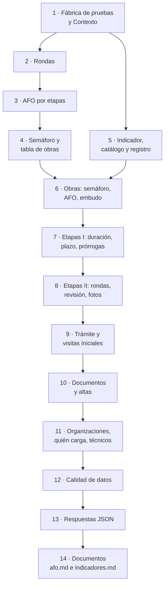
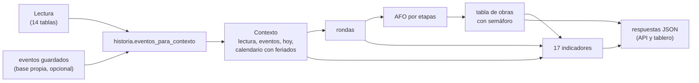
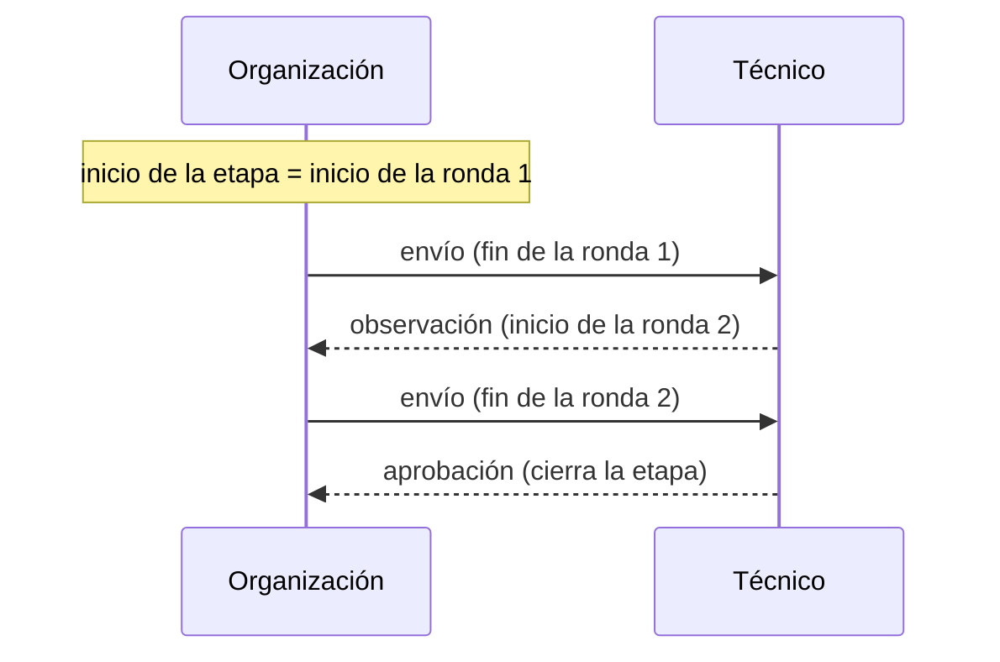

# Plan 3 · AFO por etapas, semáforo e indicadores

> **Para quien lo ejecuta (persona o agente):** seguí las tareas en orden y marcá cada casilla `- [ ]`. Si tu agente
> tiene las skills de superpowers, usá `superpowers:subagent-driven-development` (recomendado) o
> `superpowers:executing-plans`. Leé antes `../LEEME.md` y las secciones 5.1, 7.5, 8 y 9 de `../especificacion.md`.

**Objetivo:** calcular, a partir de una lectura y su historia de eventos, el AFO por etapas de cada obra, su semáforo
y los 17 indicadores de la especificación, y dejar listas las respuestas JSON que muestran la API y el tablero.

**Arquitectura:** todo es puro y trabaja sobre un `Contexto` (la lectura, los eventos ya elegidos con
`historia.eventos_para_contexto`, el día «hoy», un calendario con feriados y el desfase de las notificaciones). Así se
calcula igual con el origen en el mismo proceso (tablero sin API) o desde la base propia (Plan 4, que solo agrega cómo
armar el `Contexto` desde la base). `rondas.py` arma las rondas de cada etapa (inicio u observación → envío →
revisión) y lo usan el AFO y varios indicadores. Cada indicador es una función `calcular_<codigo>(ctx) -> Indicador`
registrada en un catálogo con su pregunta, su explicación y cómo leerlo.

**Tecnología:** pandas, numpy; pytest con lecturas armadas a mano (`tests/fabrica.py`).

**Especificación:** `../especificacion.md`, secciones 5.1 (calendario), 7.5 (historia), 8 (AFO), 9 (indicadores),
decisiones 11 a 18.

**Depende de:** el Plan 1b (`historia.py`, tabla `notificaciones`, `RECHAZADA`). **No depende del Plan 2:** se puede
hacer en paralelo. **Lo necesitan:** los Planes 4, 5 y 7.

## Restricciones globales

- Python 3.13 con `.venv`; comandos de PowerShell desde `vivso-analitica/`; todo en español.
- «H» = días hábiles con `ctx.calendario` (con feriados; decisión 13): `ctx.calendario.habiles_entre(a, b)`.
  El calendario de Java (`CALENDARIO_JAVA`) solo se usa para controlar límites que calcula Java.
- «Hoy» = `ctx.hoy` (la fecha de la lectura o de la última corrida correcta), nunca el reloj.
- Porcentajes en escala 0 a 100 redondeados a 1 decimal; medianas y percentiles con `pandas.Series.quantile`
  (interpolación lineal) redondeados a 1 decimal; un indicador sin datos devuelve `None`, nunca `NaN`.
- **Datos personales:** de las familias, solo `cantidad_familiares` y `antiguedad_rancho`; los nombres de integrantes y
  usuarios sí pueden aparecer (decisión 5), nunca tokens ni contraseñas.
- Nada de este plan importa `fastapi` ni `streamlit`; ninguna prueba usa la red (el calendario de las pruebas se arma con
  feriados fijos).
- Documentos sin «Plan N», «Claude», «superpowers» ni el host de Aiven; diagramas Mermaid 11; lenguaje llano.
- Commits en español, sin coautoría ni menciones a IA; suite completa en verde antes de cada commit.

## Foco de revisión

1. **Lectura vacía** (`ANALITICA_ORIGEN=vacio`): todos los indicadores devuelven `capacidad = "no_disponible"` con una
   nota «Todavía no hay datos», sin excepciones (prueba de contrato de la Tarea 5).
2. **Obras con historia solo de la lectura** (sin notificaciones ni versiones): las rondas anteriores a la última se
   pierden; los indicadores de rondas tienen que marcar `capacidad = "parcial"` y decirlo en una nota, no inventar.
3. **Feriado dentro de una etapa:** el límite de Java no lo cuenta y nuestro H sí; el semáforo usa el límite de Java
   (`fecha_limite`) pero cuenta los días con feriados. Una prueba del semáforo lo fija.
4. **Una etapa vencida mientras espera al técnico** (decisión 12): «vencida (N días hábiles esperando al técnico)», no
   «esperando técnico».
5. **Organizaciones con menos de 5 etapas:** sus porcentajes se muestran con la marca «pocos datos», no se esconden.

## Mapa



De la lectura al indicador:



## Archivos

| Archivo | Responsabilidad |
| :--- | :--- |
| `tests/fabrica.py` | Armar lecturas y contextos chicos para las pruebas |
| `analitica/indicadores/__init__.py`, `analitica/indicadores/contexto.py` | `Contexto`, `contexto_desde_lectura`, `calendario_de_indicadores` |
| `analitica/rondas.py` | Rondas de cada etapa |
| `analitica/afo.py` | AFO por etapas (sección 8) |
| `analitica/obras.py` | Semáforo y tabla de obras |
| `analitica/indicadores/base.py` | `Definicion`, `Indicador`, `a_dict`, confianza |
| `analitica/indicadores/registro.py` | El catálogo de los 17 y su cálculo |
| `analitica/indicadores/obras.py`, `etapas.py`, `tramite.py`, `actores.py`, `calidad.py` | Un módulo por familia |
| `analitica/respuestas.py` | El JSON de cada recurso de la API |
| `analitica/__main__.py` | Comando `catalogo` |
| `docs/afo.md`, `docs/indicadores.md` | Documentos del entregable |

---

### Tarea 1: Fábrica de pruebas y `Contexto`

**Archivos:** `tests/fabrica.py`, `analitica/indicadores/__init__.py`, `analitica/indicadores/contexto.py`,
`tests/test_contexto.py`

**Interfaces:**
- `Contexto` (dataclass congelada): `lectura: Lectura`, `eventos: pd.DataFrame` (contrato `historia.COLUMNAS_EVENTOS`),
  `hoy: date`, `calendario: Calendario`, `desfase_horas: int`, `advertencias: tuple[str, ...] = ()`; propiedades
  `origen` (`lectura.origen`), `simulado` (`origen == "simulado"`), `vacio` (no hay solicitudes), y
  `eventos_de_etapas()` (los de `entidad == "etapas"`).
- `contexto_desde_lectura(lectura: Lectura, calendario: Calendario, hoy: date | None = None,
  eventos_guardados: pd.DataFrame | None = None, desfase_horas: int | None = None,
  advertencias: Sequence[str] = ()) -> Contexto`: `hoy` por defecto `lectura.leido_en.date()`; `desfase_horas` por
  defecto `historia.estimar_desfase_horas(lectura)`; `eventos = historia.eventos_para_contexto(lectura,
  eventos_guardados, desfase_horas)`.
- `calendario_de_indicadores(cfg: Configuracion, anios: Iterable[int]) -> tuple[Calendario, list[str]]`: con
  `feriados.cargar(anios, url=cfg.feriados_url, tipos=cfg.feriados_tipos)`; devuelve el calendario y las advertencias.
  (No se usa en las pruebas, que arman el calendario con fechas fijas.)
- En `tests/fabrica.py`:
  - `lectura(origen="simulado", leido_en=datetime(2026, 9, 30, 23, 59, 59), **tablas: list[dict]) -> Lectura` (las
    tablas que no se pasan, vacías; pasa `verificar_lectura`).
  - `etapa(id_etapa_obra, id_solicitud, numero, estado, **campos) -> dict` (completa `etapa=f"ETAPA_{numero}"` y, si no
    se pasa, `fecha_limite_original = fecha_limite`).
  - `obra(id_solicitud, inicio: date, aprobadas: int, estado_actual: str | None = "EN_CURSO") -> list[dict]`: las 6
    etapas (ids `id_solicitud * 10 + numero`) con `CALENDARIO_JAVA`: cada etapa aprobada empieza el día en que se aprobó
    la anterior, vence a sus días estimados, se envía su último día a las 09:00 y se aprueba a las 10:00 (`id_revisor=5`,
    `id_usuario_envio=11`). La etapa `aprobadas + 1` queda en `estado_actual` desde el día de la última aprobación; si
    el estado es `EN_REVISION`, `OBSERVADA` o `RECHAZADA` lleva `fecha_envio` = su límite a las 09:00, y `OBSERVADA` o
    `RECHAZADA` además `fecha_revision` = su límite a las 10:00. El resto, `PENDIENTE`.
  - `solicitud(id_solicitud, **campos) -> dict` (por defecto `estado="Aprobada"`, `cuit_org="30-11111111-1"`,
    `id_familia=id_solicitud`, `num_exp=f"EXP-2026-{id_solicitud:04d}"`, `fecha_solicitud=date(2026, 8, 3)`,
    `fecha_activacion=date(2026, 9, 1)`, `id_tecnico_asignado=5`), `organizacion(cuit="30-11111111-1", **campos)`,
    `usuario(id_usuario, rol, **campos)`, `integrante(id_integrante, id_usuario, cargo, **campos)`,
    `foto(id_foto, id_etapa_obra, fecha_subida, id_usuario_subida=11)`.
  - `contexto(lectura, hoy=None, feriados=(), eventos_guardados=None) -> Contexto`.
  - `lectura_historia_de_ejemplo() -> Lectura`: la obra con notificaciones del Plan 1b (Tarea 7: solicitud 1,
    notificaciones 1 a 9) más una foto de la etapa 1 el 2026-10-19 09:00:00 (id 1), una de la etapa 2 el 2026-10-21
    10:00:00 (id 2), el usuario técnico 5, los integrantes 11 (`PRESIDENTE`) y 12 (`TESORERO`) y
    `leido_en = 2026-10-23 23:59:59`.

- [ ] **Paso 1: pruebas que fallan** (`tests/test_contexto.py`):

```python
def test_el_contexto_de_una_lectura():
    ctx = contexto(lectura_historia_de_ejemplo())
    assert ctx.hoy == date(2026, 10, 23) and ctx.desfase_horas == 0 and ctx.simulado and not ctx.vacio
    assert set(ctx.eventos_de_etapas()["fuente"]) == {"notificaciones"}


def test_la_fabrica_arma_una_obra_como_java():
    filas = {e["numero"]: e for e in obra(1, date(2026, 9, 7), aprobadas=2)}
    assert (filas[1]["fecha_limite"], filas[2]["fecha_limite"]) == (date(2026, 9, 9), date(2026, 9, 11))
    assert (filas[3]["estado"], filas[3]["fecha_inicio"], filas[3]["fecha_limite"]) == ("EN_CURSO", date(2026, 9, 11), date(2026, 9, 25))
    assert filas[2]["fecha_revision"] == datetime(2026, 9, 11, 10, 0) and filas[4]["estado"] == "PENDIENTE"


def test_una_lectura_vacia_da_un_contexto_vacio():
    assert contexto(lectura()).vacio
```

- [ ] **Pasos 2 a 4:** correr (falla), implementar, suite en verde.
- [ ] **Paso 5: commit** `"Armar el contexto de cálculo de los indicadores y la fábrica de lecturas de prueba"`.

### Tarea 2: Rondas de cada etapa

**Archivos:** `analitica/rondas.py`, `tests/test_rondas.py`

**Interfaces:**
- `COLUMNAS_RONDAS = ("id_solicitud", "numero", "id_etapa_obra", "ronda", "inicio_ronda", "envio", "revision",
  "resultado", "fotos", "fuente")`
- `rondas(ctx: Contexto) -> pd.DataFrame`: una fila por envío de cada etapa. `inicio_ronda` = el último `inicio` u
  `observacion` de esa etapa anterior al envío; `revision` y `resultado` = el primer `observacion`, `aprobacion` o
  `rechazo` posterior al envío y anterior al envío siguiente (vacíos si todavía no la revisaron); `fotos` = fotos de la
  etapa con `inicio_ronda < fecha_subida <= envio`; `fuente` = la de los eventos de esa etapa. Las prórrogas no cortan
  rondas.



- [ ] **Paso 1: pruebas que fallan:**

```python
def test_rondas_de_la_historia_de_ejemplo():
    tabla = rondas(contexto(lectura_historia_de_ejemplo()))
    filas = [(r.numero, r.ronda, r.inicio_ronda.to_pydatetime(), r.envio.to_pydatetime(),
              None if pd.isna(r.resultado) else r.resultado, r.fotos) for r in tabla.itertuples()]
    assert filas == [
        (1, 1, datetime(2026, 10, 16, 10, 15, 42), datetime(2026, 10, 19, 9, 5, 30), "observacion", 1),
        (1, 2, datetime(2026, 10, 19, 12, 0, 10), datetime(2026, 10, 19, 15, 0, 20), "aprobacion", 0),
        (2, 1, datetime(2026, 10, 20, 11, 30, 59), datetime(2026, 10, 21, 16, 10, 0), None, 1),
    ]


def test_sin_envios_no_hay_rondas():
    assert rondas(contexto(lectura(solicitudes=[solicitud(1)], etapas=obra(1, date(2026, 9, 28), 0)))).empty
```

- [ ] **Pasos 2 a 4:** correr, implementar, suite en verde.
- [ ] **Paso 5: commit** `"Armar las rondas de cada etapa desde la historia"`.

### Tarea 3: AFO por etapas

**Archivos:** `analitica/afo.py`, `tests/test_afo.py`

**Interfaces (las usan la Tarea 4, el Plan 5 y el Plan 7):**
- `COLUMNAS_AFO = ("id_solicitud", "inicio_obra", "etapa_actual", "estado_etapa", "etapas_aprobadas", "afo",
  "afo_plan", "brecha_habiles", "vencida_habiles", "fotos_etapa_actual", "aprobadas_sin_fotos", "historia")`
- `fin_plan(calendario: Calendario, inicio_obra: date, numero: int) -> date` = `calendario.sumar_habiles(inicio_obra,
  suma de dias_estimados de las etapas 1..numero)`.
- `calcular_afo(ctx: Contexto, dia: date | None = None) -> pd.DataFrame` (una fila por obra con `ETAPA_1` iniciada a
  más tardar ese día; `dia` por defecto `ctx.hoy`).

Definiciones (especificación, sección 8):

| Campo | Cálculo |
| :--- | :--- |
| `inicio_obra` | `fecha_inicio` de `ETAPA_1` |
| `etapas_aprobadas` | etapas `APROBADA` con `fecha_revision.date() <= dia` |
| `etapa_actual`, `estado_etapa` | solo si `dia == ctx.hoy`: con una etapa `RECHAZADA`, esa y `"RECHAZADA"`; con las 6 aprobadas, vacía y `"FINALIZADA"`; si no, la etapa activa y su estado. Si `dia < ctx.hoy`: `etapas_aprobadas + 1` (hasta 6) y estado vacío |
| `afo` | `100 × Σ dias_estimados de las aprobadas a dia / 29`, 1 decimal |
| `afo_plan` | `100 × Σ dias_estimados de las k con fin_plan(k) <= dia / 29`, 1 decimal |
| `brecha_habiles` | días estimados del plan − días estimados aprobados (positivo: atrasada) |
| `vencida_habiles` | solo con `dia == ctx.hoy` y una etapa activa con `dia > fecha_limite`: `H(fecha_limite, dia)`; si no, 0 |
| `fotos_etapa_actual` | fotos de la etapa activa subidas después del inicio de su ronda en curso (último `inicio` u `observacion`) |
| `aprobadas_sin_fotos` | etapas aprobadas cuya última ronda tiene `fotos == 0` |
| `historia` | `"completa"` si los eventos de etapa de la obra vienen de `notificaciones` o `versiones`; si no, `"parcial"` |

- [ ] **Paso 1: pruebas que fallan.** Escenario, armado por `fabrica.escenario_afo() -> Contexto` (lo reusan la
  Tarea 4, la Tarea 6 y el informe semanal del Plan 6; la fixture `escenario` lo devuelve), con `hoy = 2026-09-30` y
  sin feriados: la organización por defecto (tipo «Asociación Civil»), las solicitudes 1, 2 y 3 con su vivienda
  completa (departamento «Capital», tipo `URBANA`), obra 1 = `obra(1, date(2026, 9, 7), 2)` con una foto de la etapa 1
  el 2026-09-08 10:00 y una de la etapa 3 el 2026-09-15 10:00; obra 2 = `obra(2, date(2026, 8, 3), 6, None)`; obra 3 =
  `obra(3, date(2026, 9, 21), 0, "RECHAZADA")`.

```python
def test_afo_a_hoy(escenario):
    afo = calcular_afo(escenario).set_index("id_solicitud")
    assert afo.loc[1, ["etapa_actual", "estado_etapa", "etapas_aprobadas", "afo", "afo_plan", "brecha_habiles",
                       "vencida_habiles", "fotos_etapa_actual", "aprobadas_sin_fotos", "historia"]].tolist() == [
        3, "EN_CURSO", 2, 13.8, 48.3, 10, 3, 1, 1, "parcial"]
    assert afo.loc[2, ["estado_etapa", "afo", "brecha_habiles", "vencida_habiles"]].tolist() == ["FINALIZADA", 100.0, 0, 0]
    assert afo.loc[3, ["etapa_actual", "estado_etapa", "afo", "afo_plan", "brecha_habiles", "vencida_habiles"]].tolist() == [
        1, "RECHAZADA", 0.0, 13.8, 4, 0]


def test_afo_a_un_dia_pasado(escenario):
    afo = calcular_afo(escenario, dia=date(2026, 9, 10)).set_index("id_solicitud")
    assert set(afo.index) == {1, 2}                              # la obra 3 empezó el 21/09
    assert afo.loc[1, ["etapas_aprobadas", "afo", "afo_plan", "brecha_habiles"]].tolist() == [1, 6.9, 6.9, 0]
    assert afo.loc[2, ["etapas_aprobadas", "afo"]].tolist() == [5, 93.1]


def test_con_notificaciones_la_historia_es_completa():
    afo = calcular_afo(contexto(lectura_historia_de_ejemplo()))
    assert afo["historia"].tolist() == ["completa"]


def test_un_feriado_corre_el_plan():
    sin = calcular_afo(contexto(lectura(solicitudes=[solicitud(1)], etapas=obra(1, date(2026, 9, 7), 2)),
                                hoy=date(2026, 9, 25)))
    con = calcular_afo(contexto(lectura(solicitudes=[solicitud(1)], etapas=obra(1, date(2026, 9, 7), 2)),
                                hoy=date(2026, 9, 25), feriados=[date(2026, 9, 21)]))
    assert sin["afo_plan"].item() == 48.3 and con["afo_plan"].item() == 13.8     # la etapa 3 del plan termina el 28/09
```

- [ ] **Pasos 2 a 4:** correr, implementar, suite en verde.
- [ ] **Paso 5: commit** `"Calcular el AFO por etapas con el plan contra lo real"`.

### Tarea 4: Semáforo y tabla de obras

**Archivos:** `analitica/obras.py`, `tests/test_obras.py`

**Interfaces (las usan los Planes 4 y 5):**
- `SEMAFOROS: dict[str, str]` (código → texto): `en_plazo` «En plazo», `por_vencer` «Por vencer», `vencida` «Vencida»,
  `vencida_con_prorroga` «Vencida con prórroga», `esperando_tecnico` «Esperando al técnico», `revision_demorada`
  «Revisión demorada», `vencida_esperando_tecnico` «Vencida esperando al técnico», `rechazada` «Rechazada»,
  `terminada` «Terminada». (Orden de gravedad para los colores del tablero: `rechazada`, `vencida_esperando_tecnico`,
  `vencida_con_prorroga`, `vencida`, `revision_demorada`, `por_vencer`, `esperando_tecnico`, `en_plazo`, `terminada`.)
- `semaforo(etapas_de_la_obra: pd.DataFrame, hoy: date, calendario: Calendario) -> tuple[str, str]`: código y texto;
  para `vencida_esperando_tecnico` el texto es `f"Vencida ({n} días hábiles esperando al técnico)"` con
  `n = H(fecha_envio, hoy)`. Reglas: las de `semaforo_obras` en la sección 9 de la especificación.
- `COLUMNAS_OBRAS = ("id_solicitud", "num_exp", "cuit", "organizacion", "grupo", "departamento", "localidad",
  "tipo_vivienda", "id_tecnico_asignado", "tecnico", "inicio_obra", "etapa_actual", "etapa_nombre", "estado_etapa",
  "fecha_limite", "semaforo", "semaforo_texto", "dias_habiles_restantes", "etapas_aprobadas", "afo", "afo_plan",
  "brecha_habiles", "vencida_habiles", "historia")`
- `tabla_obras(ctx: Contexto) -> pd.DataFrame`: `calcular_afo(ctx)` más la solicitud, la organización
  (`catalogo.grupo_organizacion(tipo, nombre).grupo`), el departamento y la localidad (de la vivienda si está completa;
  si no, de la visita inicial), el técnico (`usuarios.username` del `id_tecnico_asignado`), la etapa actual
  (`catalogo.etapa(...).nombre`) y su `fecha_limite`; `dias_habiles_restantes = calendario.habiles_restantes(hoy,
  fecha_limite)`. Ordenada por gravedad del semáforo y después por `id_solicitud`.

- [ ] **Paso 1: pruebas que fallan** (`hoy = 2026-09-30`; cada caso es una sola etapa activa con `etapa(...)`):

```python
@pytest.mark.parametrize("estado, campos, esperado", [
    ("EN_CURSO", {"fecha_limite": date(2026, 10, 12)}, "en_plazo"),
    ("OBSERVADA", {"fecha_limite": date(2026, 10, 12)}, "en_plazo"),
    ("EN_CURSO", {"fecha_limite": date(2026, 10, 1)}, "por_vencer"),
    ("EN_CURSO", {"fecha_limite": date(2026, 9, 29)}, "vencida"),
    ("PRORROGADA", {"fecha_limite": date(2026, 9, 29), "fecha_limite_original": date(2026, 9, 25)}, "vencida_con_prorroga"),
    ("EN_REVISION", {"fecha_limite": date(2026, 10, 12), "fecha_envio": datetime(2026, 9, 29, 10)}, "esperando_tecnico"),
    ("EN_REVISION", {"fecha_limite": date(2026, 10, 12), "fecha_envio": datetime(2026, 9, 25, 10)}, "revision_demorada"),
    ("EN_REVISION", {"fecha_limite": date(2026, 9, 28), "fecha_envio": datetime(2026, 9, 25, 10)}, "vencida_esperando_tecnico"),
    ("RECHAZADA", {"fecha_limite": date(2026, 10, 12)}, "rechazada"),
])
def test_semaforo(estado, campos, esperado):
    etapas = pd.DataFrame([etapa(13, 1, 3, estado, fecha_inicio=date(2026, 9, 14), **campos)])
    assert semaforo(etapas, date(2026, 9, 30), Calendario())[0] == esperado


def test_texto_de_vencida_esperando_y_terminada():
    etapas = pd.DataFrame([etapa(13, 1, 3, "EN_REVISION", fecha_inicio=date(2026, 9, 14), fecha_limite=date(2026, 9, 28),
                                 fecha_envio=datetime(2026, 9, 25, 10))])
    assert semaforo(etapas, date(2026, 9, 30), Calendario())[1] == "Vencida (3 días hábiles esperando al técnico)"
    assert semaforo(pd.DataFrame(obra(2, date(2026, 8, 3), 6, None)), date(2026, 9, 30), Calendario())[0] == "terminada"


def test_un_feriado_cambia_por_vencer():
    etapas = pd.DataFrame([etapa(13, 1, 3, "EN_CURSO", fecha_inicio=date(2026, 9, 14), fecha_limite=date(2026, 10, 2))])
    assert semaforo(etapas, date(2026, 9, 30), Calendario())[0] == "en_plazo"                       # H = 2
    assert semaforo(etapas, date(2026, 9, 30), Calendario([date(2026, 10, 1)]))[0] == "por_vencer"  # H = 1


def test_tabla_de_obras(escenario):          # el escenario de la Tarea 3, más la organización y las viviendas
    tabla = tabla_obras(escenario)
    assert list(tabla.columns) == list(COLUMNAS_OBRAS)
    assert tabla["semaforo"].tolist() == ["rechazada", "vencida", "terminada"]
    fila = tabla.set_index("id_solicitud").loc[1]
    assert (fila["etapa_nombre"], fila["grupo"], fila["dias_habiles_restantes"]) == ("Elevación y techo", "ONG", 0)
```

- [ ] **Pasos 2 a 4:** correr, implementar, suite en verde.
- [ ] **Paso 5: commit** `"Calcular el semáforo de cada obra y la tabla de obras"`.

### Tarea 5: Indicador, catálogo y registro

**Archivos:** `analitica/indicadores/base.py`, `analitica/indicadores/registro.py`, `tests/test_registro.py`

**Interfaces:**
- `CONFIANZAS = ("confirmado", "inferido", "sin_confirmar")`, `CAPACIDADES = ("disponible", "parcial", "no_disponible")`
- `Definicion` (dataclass congelada): `codigo`, `titulo`, `familia` (`obras`, `etapas`, `tramite`, `actores`,
  `calidad`), `pregunta`, `explicacion`, `como_leerlo`, `unidad`.
- `Indicador` (dataclass congelada): `definicion: Definicion`, `confianza: str`, `capacidad: str`,
  `resumen: dict[str, int | float | str | None]`, `tablas: dict[str, pd.DataFrame]`, `notas: tuple[str, ...] = ()`;
  propiedad `codigo`.
- `confianza_de(ctx: Contexto, usa_intervalos: bool) -> str`: `sin_confirmar` con el origen simulado; si no,
  `inferido` si usa eventos de precisión `intervalo` o de fuente `lectura`, y `confirmado` si no.
- `sin_datos(definicion, ctx) -> Indicador`: `capacidad = "no_disponible"`, resumen vacío, nota «Todavía no hay datos».
- `a_dict(indicador: Indicador) -> dict`: todo lo anterior en JSON (cada tabla como lista de registros; fechas en ISO;
  `NaN` → `None`).
- `registro.CATALOGO: dict[str, Definicion]` con los 17 códigos en el orden de la especificación (`semaforo_obras`,
  `afo`, `embudo_obras`, `duracion_etapa`, `cumplimiento_plazo`, `prorrogas`, `observaciones_rondas`,
  `tiempo_revision`, `evidencia_fotos`, `quien_carga`, `tramite_solicitudes`, `visitas_iniciales`,
  `circuito_documental`, `alta_organizaciones`, `desempeno_organizacion`, `carga_tecnicos`, `calidad_datos`).
  `pregunta` = la pregunta que responde, en una oración (por ejemplo, para `prorrogas`: «¿Cuántas etapas necesitan más
  tiempo y cuánto?»); `explicacion` y `como_leerlo`, dos o tres oraciones cada una, sin jerga (las escribe quien
  implementa, siguiendo la definición de la sección 9 de la especificación).
- `registro.FUNCIONES: dict[str, Callable[[Contexto], Indicador]]` (se completa en las Tareas 6 a 12),
  `calcular(codigo, ctx) -> Indicador` (`KeyError` claro si no existe), `calcular_todos(ctx) -> list[Indicador]`: en el
  orden del catálogo; si uno lanza una excepción, ese indicador sale `no_disponible` con la nota `"No se pudo
  calcular: <tipo del error>"` y los demás siguen.

- [ ] **Paso 1: pruebas que fallan** (`tests/test_registro.py`; la última se completa sola a medida que se registran):

```python
def test_el_catalogo_tiene_los_17_con_textos():
    assert list(CATALOGO) == CODIGOS_ESPERADOS               # la lista de arriba, en ese orden
    for d in CATALOGO.values():
        assert d.pregunta.endswith("?") and len(d.explicacion) > 40 and len(d.como_leerlo) > 40


@pytest.mark.parametrize("codigo", list(FUNCIONES))
def test_contrato_de_cada_indicador(codigo, contexto_simulado, contexto_vacio):
    con_datos = calcular(codigo, contexto_simulado)
    assert con_datos.capacidad in ("disponible", "parcial") and con_datos.confianza == "sin_confirmar"
    json.dumps(a_dict(con_datos))                            # se puede serializar
    vacio = calcular(codigo, contexto_vacio)
    assert vacio.capacidad == "no_disponible" and "Todavía no hay datos" in vacio.notas


def test_un_indicador_que_falla_no_tumba_a_los_demas(monkeypatch, contexto_simulado):
    monkeypatch.setitem(FUNCIONES, "afo", lambda ctx: 1 / 0)
    indicadores = {i.codigo: i for i in calcular_todos(contexto_simulado)}
    assert indicadores["afo"].capacidad == "no_disponible" and "ZeroDivisionError" in indicadores["afo"].notas[0]
```

  Fixtures en `tests/conftest.py` (con alcance de sesión, para no recalcular): `contexto_simulado` (el origen simulado
  con semilla 8 al 2026-10-15, sin feriados) y `contexto_vacio` (el origen vacío).
- [ ] **Pasos 2 a 4:** correr, implementar, suite en verde.
- [ ] **Paso 5: commit** `"Definir el indicador, su catálogo y su registro"`.

### Tareas 6 a 12: los 17 indicadores

Cada indicador es `calcular_<codigo>(ctx: Contexto) -> Indicador`, se registra en `FUNCIONES` y cumple el contrato de
la Tarea 5. Para cada uno se da: módulo, `resumen` (claves), `tablas` (nombre → columnas), la regla que falta en la
especificación y sus pruebas con valores exactos. Salvo que se diga otra cosa, «etapas iniciadas» = con `fecha_inicio`,
y la confianza es `confianza_de(ctx, usa_intervalos=False)`.

Cada tarea sigue los mismos pasos:

- [ ] **Paso 1:** escribir las pruebas que fallan de la tarea (`tests/test_indicadores_<familia>.py`).
- [ ] **Paso 2:** correrlas → fallan.
- [ ] **Paso 3:** implementar y registrar.
- [ ] **Paso 4:** suite completa en verde (incluye el contrato de la Tarea 5).
- [ ] **Paso 5:** commit con el mensaje de la tarea.

### Tarea 6: Obras (`indicadores/obras.py`) — commit `"Sumar los indicadores de semáforo, AFO y embudo de obras"`

| Código | `resumen` | `tablas` |
| :--- | :--- | :--- |
| `semaforo_obras` | `obras` y una clave por código de `SEMAFOROS` (conteos) | `obras`: `id_solicitud`, `num_exp`, `organizacion`, `departamento`, `etapa_actual`, `estado_etapa`, `fecha_limite`, `semaforo`, `semaforo_texto`, `dias_habiles_restantes` |
| `afo` | `obras`, `afo_mediano`, `afo_plan_mediano`, `atrasadas_mas_de_5` (brecha > 5), `terminadas`, `rechazadas` | `por_etapa_actual` (`etapa_actual`, `estado_etapa`, `obras`), `distribucion` (`rango` en «0–25», «25–50», «50–75», «75–100» con el 100 aparte como «100», `obras`), `por_grupo`, `por_organizacion`, `por_tipo_vivienda`, `por_departamento` (cada una: la dimensión, `obras`, `afo_mediano`, `brecha_mediana`) |
| `embudo_obras` | `solicitudes`, `con_expediente`, `con_visita`, `aprobadas`, `vivienda_completada`, `iniciadas`, `terminadas`, `duracion_mediana_habiles`, `tiempo_organizacion_mediano`, `tiempo_revision_mediano` | `embudo` (`paso`, `cantidad`, `pct_del_anterior`), `por_cohorte` (`cohorte` = mes de `fecha_solicitud` «AAAA-MM», `solicitudes`, `aprobadas`, `iniciadas`, `terminadas`) |

- `embudo_obras`: duración = `H(inicio de ETAPA_1, fecha_revision de ETAPA_6)` de las terminadas; tiempo de la
  organización = suma por ronda de `H(inicio_ronda, envio)`; tiempo de revisión = suma de `H(envio, revision)`; ambos
  con `rondas()`, por obra terminada. Si alguna obra terminada tiene historia `parcial`, `capacidad = "parcial"`.
- **Pruebas:** con el escenario de la Tarea 3, `semaforo_obras` da `{"obras": 3, "rechazada": 1, "vencida": 1,
  "terminada": 1}` (las demás claves en 0); `afo` da `terminadas = 1`, `rechazadas = 1`, `atrasadas_mas_de_5 = 1`
  (la obra 1, brecha 10). `embudo_obras` con tres solicitudes (una `Pendiente` sin expediente, una `Aprobada` sin obra y
  la obra 2 terminada): `embudo` = solicitudes 3, con expediente 2, aprobadas 2, iniciadas 1, terminadas 1, y
  `duracion_mediana_habiles = 29.0`.

### Tarea 7: Etapas I (`indicadores/etapas.py`) — commit `"Sumar los indicadores de duración, cumplimiento de plazo y prórrogas"`

| Código | `resumen` | `tablas` |
| :--- | :--- | :--- |
| `duracion_etapa` | `etapas_aprobadas`, `pct_en_estimado` | `por_etapa`: `numero`, `nombre`, `dias_estimados`, `cantidad`, `mediana`, `p75`, `maximo`, `desvio_mediano`, `pct_en_estimado` |
| `cumplimiento_plazo` | `universo`, `pct_primer_envio_en_plazo_original`, `pct_ultimo_envio_en_plazo_vigente` | `por_etapa`: `numero`, `universo`, `pct_original`, `pct_vigente` |
| `prorrogas` | `etapas_iniciadas`, `prorrogadas`, `pct_prorrogadas`, `mediana_dias`, `pct_mas_de_14`, `prorrogas_notificadas` | `por_etapa` y `por_organizacion` (`iniciadas`, `prorrogadas`, `pct`), `motivos` (`motivo`, `cantidad`) |

- `duracion_etapa`: `d = H(fecha_inicio, fecha_revision)` de las `APROBADA`; desvío = `d − dias_estimados`.
- `cumplimiento_plazo`: universo = etapas con algún envío más las activas sin envío con `hoy > fecha_limite`. Primer
  envío = la ronda 1 de `rondas()`; último = la última. «En plazo» compara la fecha del envío (`.date()`) con el límite.
  Si la etapa no tiene rondas de notificaciones o versiones, el primer envío es el último conocido y la confianza baja a
  `inferido` (o `sin_confirmar` en el simulado).
- `prorrogas`: prorrogada = `fecha_limite ≠ fecha_limite_original`; días = `H(fecha_limite_original, fecha_limite)`;
  tope de 14 días hábiles (decisión 14); `prorrogas_notificadas` = eventos `prorroga` de fuente `notificaciones`
  (cuenta las encadenadas).
- **Pruebas:** obras 1 y 2 del escenario más una obra 4 cuya etapa 1 empezó el 2026-09-07 y se aprobó el 2026-09-10
  10:00 → en la etapa 1, `cantidad = 3`, `mediana = 2.0`, `maximo = 3`, `pct_en_estimado = 66.7`. Para el plazo: etapa X
  (original 09-09, envío 09-08), etapa Y (original 09-09, límite 09-14, motivo «lluvias», envío 09-11), etapa Z
  (`EN_CURSO`, límite 09-25, sin envío, `hoy = 09-30`) → `universo = 3`, `pct_primer_envio_en_plazo_original = 33.3`,
  `pct_ultimo_envio_en_plazo_vigente = 66.7`; `prorrogas` → `prorrogadas = 1`, `pct_prorrogadas = 33.3`,
  `mediana_dias = 3.0`, `pct_mas_de_14 = 0.0`, `motivos = [{"motivo": "lluvias", "cantidad": 1}]`.

### Tarea 8: Etapas II (`indicadores/etapas.py`) — commit `"Sumar los indicadores de rondas, tiempo de revisión y evidencia en fotos"`

| Código | `resumen` | `tablas` |
| :--- | :--- | :--- |
| `observaciones_rondas` | `etapas_enviadas`, `con_dos_o_mas`, `tasa`, `cuello_de_botella` (número de etapa con mayor tasa) | `por_etapa`: `numero`, `enviadas`, `con_observacion`, `tasa`, `rondas_media` |
| `tiempo_revision` | `rondas_revisadas`, `mediana`, `p90`, `en_cola`, `cola_mas_antigua` | `por_etapa`, `por_tecnico` (`tecnico`, `revisiones`, `mediana`, `p90`), `cola` (`id_solicitud`, `num_exp`, `numero`, `fecha_envio`, `habiles_esperando`, `tecnico`) |
| `evidencia_fotos` | `rondas`, `fotos_por_ronda_mediana`, `rondas_sin_fotos`, `aprobadas_sin_fotos`, `fotos_borradas`, `fotos_fuera_de_horario`, `rafagas` | `por_etapa` (`numero`, `rondas`, `fotos_mediana`, `sin_fotos`), `aprobadas_sin_fotos_por_tecnico` (`tecnico`, `cantidad`) |

- `observaciones_rondas` y `tiempo_revision` usan `rondas()`; si alguna etapa enviada tiene historia `parcial`,
  `capacidad = "parcial"` con la nota «Algunas etapas solo tienen su último envío: las rondas anteriores no se ven».
- `tiempo_revision`: `r = H(envio, revision)` por ronda revisada; el técnico de cada revisión es el asignado a la
  solicitud (solo él puede revisar). Cola = etapas `EN_REVISION` hoy, con `H(fecha_envio, hoy)`.
- `evidencia_fotos`: `fotos_borradas` = eventos `foto_borrada` (solo con versiones; sin base propia, `None` y una
  nota); fuera de horario = subidas antes de las 7, desde las 21 o en sábado o domingo; ráfaga = 3 o más fotos de la
  misma etapa en 2 minutos o menos (señal de carga sin conexión).
- **Pruebas** con `lectura_historia_de_ejemplo()` (`hoy = 2026-10-23`): `observaciones_rondas` → `etapas_enviadas = 2`,
  `con_dos_o_mas = 1`, `tasa = 50.0`, `cuello_de_botella = 1`; `tiempo_revision` → `rondas_revisadas = 2`,
  `mediana = 0.5` (0 y 1 días hábiles), `en_cola = 1`, `cola_mas_antigua = 2`; `evidencia_fotos` → `rondas = 3`,
  `rondas_sin_fotos = 1`, `aprobadas_sin_fotos = 1`; agregando una foto de la etapa 2 el 2026-10-21 23:10,
  `fotos_fuera_de_horario = 1`; con tres fotos de la etapa 2 a las 10:00:00, 10:00:30 y 10:01:10, `rafagas = 1`.

### Tarea 9: Trámite (`indicadores/tramite.py`) — commit `"Sumar los indicadores del trámite de solicitudes y de las visitas iniciales"`

| Código | `resumen` | `tablas` |
| :--- | :--- | :--- |
| `tramite_solicitudes` | `solicitudes`, `mediana_dias_registro_visita`, `mediana_dias_visita_aprobacion`, `mediana_dias_registro_aprobacion`, `pct_semiaprobadas`, `rechazadas` | `tiempos` (`tramo`, `cantidad`, `mediana`, `p75`, `precision`), `por_operador` (`operador`, `aprobadas`, `rechazadas`, `semiaprobadas`), `motivos_rechazo` (`motivo`, `cantidad`) |
| `visitas_iniciales` | `visitas`, `pct_prioridad_social`, `diferencia_media_habitantes`, `mediana_dias_solicitud_visita` | `clasificaciones` (`clasificacion`, `valor` del catálogo, `visitas`, `pct`, `tasa_aprobacion`), `por_departamento` (`departamento`, `visitas`, `pct_prioridad`) |

- Días **corridos** (es trámite, no obra). Registro → expediente solo si hay eventos `expediente_asignado` (versiones):
  si no, ese tramo sale con `cantidad = 0` y la nota «hace falta la base propia para fechar la asignación del
  expediente». `pct_semiaprobadas` = solicitudes hoy `SemiAprobada` o con un evento `solicitud_semiaprobada`, sobre
  todas. Operador = `usuarios.username` del `id_revisor`.
- `diferencia_media_habitantes` = media de `habitantes − cantidad_familiares` (de `familias`, solo el conteo).
- **Pruebas:** tres solicitudes: 1 (registro 08-03, visita 08-10 10:00, activación 08-24), 2 (08-05, 08-20, 09-04) y
  3 (`SemiAprobada`) → medianas 11.0, 14.5 y 25.5, `pct_semiaprobadas = 33.3`. Dos visitas: `TIPO_1A` con prioridad,
  4 habitantes y familia de 3 (solicitud aprobada), y `TIPO_2A` sin prioridad, 2 habitantes y familia de 2 (solicitud
  pendiente) → `pct_prioridad_social = 50.0`, `diferencia_media_habitantes = 0.5`; en `clasificaciones`, `1a` con
  `tasa_aprobacion = 100.0` y `2a` con `0.0`.

### Tarea 10: Documentos y altas (`indicadores/tramite.py`) — commit `"Sumar los indicadores del circuito documental y del alta de organizaciones"`

| Código | `resumen` | `tablas` |
| :--- | :--- | :--- |
| `circuito_documental` | `documentos`, `pendientes`, `a_corregir`, `pct_marcados`, `mediana_dias_revision`, `rechazados` | `por_tipo` (`tipo`, `valor`, `ambito`, `documentos`, `marcados`, `pct_marcados`, `mediana_dias_revision`), `pendientes_por_organizacion` (`cuit`, `organizacion`, `pendientes`), `por_operador` (`operador`, `revisados`) |
| `alta_organizaciones` | `altas`, `aprobadas`, `rechazadas`, `pendientes`, `pct_observadas`, `pct_rechazadas`, `duracion_mediana`, `vigencia_vencida`, `vigencia_por_vencer`, `asamblea_vieja` | `organizaciones` (`cuit`, `nombre`, `grupo`, `fecha_vencimiento_vigencia`, `estado_vigencia`, `fecha_ultima_asamblea`, `asamblea_vieja`), `por_grupo` (`grupo`, `organizaciones`, `vencidas`, `por_vencer`) |

- Marcado = hoy `A_CORREGIR`, o `PENDIENTE` con `fecha_revision` (ya fue marcado y se reemplazó). Días de revisión =
  `(fecha_revision − fecha_subida)` en días con decimales, de los que tienen `fecha_revision`. Los estados se muestran tal
  cual (decisión 18). Un documento de familia se atribuye a la organización de su solicitud.
- Vigencia: `vencida` si `fecha_vencimiento_vigencia < hoy`; `por_vencer` si vence en 60 días corridos o menos;
  `vigente` si no. `asamblea_vieja` = última asamblea hace más de 730 días (renovación bianual). Duración del alta =
  días corridos de `fecha_solicitud` a `fecha_aprobacion` o `fecha_rechazo`. Observadas = hoy `SemiAprobada` o con un
  evento `alta_observada`.
- **Pruebas** (`hoy = 2026-09-30`): tres documentos `DNI_FAMILIARES`: uno `PENDIENTE` sin revisión, uno `A_CORREGIR`
  (subido 09-01 10:00, revisado 09-03 10:00) y uno `PENDIENTE` revisado (subido 09-01 10:00, revisado 09-02 10:00) →
  `pct_marcados = 66.7`, `mediana_dias_revision = 1.5`, `pendientes = 2`, `a_corregir = 1`. Tres organizaciones:
  vigencia 2026-09-01 y asamblea 2024-01-10 (vencida y vieja), vigencia 2026-11-15 (por vencer, 46 días), vigencia
  2027-06-01 (vigente) → `vigencia_vencida = 1`, `vigencia_por_vencer = 1`, `asamblea_vieja = 1`. Tres altas: aprobada
  (2025-01-02 → 2025-01-12), rechazada (2025-02-01 → 2025-02-21) y pendiente → `duracion_mediana = 15.0`,
  `pct_rechazadas = 33.3`.

### Tarea 11: Organizaciones, quién carga y técnicos (`indicadores/actores.py`) — commit `"Sumar los indicadores por organización, por cargo y por técnico"`

| Código | `resumen` | `tablas` |
| :--- | :--- | :--- |
| `desempeno_organizacion` | `organizaciones`, `con_pocos_datos` | `por_organizacion` (`cuit`, `organizacion`, `grupo`, `etapas`, `pct_en_plazo`, `pct_prorrogadas`, `tasa_observacion`, `desvio_mediano`, `brecha_mediana`, `obras_vencidas_hoy`, `documentos_a_corregir`, `estado_vigencia`, `pocos_datos`), `por_grupo` (las mismas métricas por OG y ONG) |
| `quien_carga` | `envios`, `fotos`, `pct_envios_presidente`, `pct_envios_tesorero`, `pct_envios_otros` | `por_cargo` (`cargo`, `envios`, `fotos`), `por_organizacion` (`cuit`, `organizacion`, `integrantes_activos`, `con_usuario`, `envios`, `fotos`) |
| `carga_tecnicos` | `tecnicos`, `cola_total`, `revisiones_30_dias` | `tecnicos` (`id_usuario`, `tecnico` = username, `nombre`, `apellido`, `obras_asignadas`, `revisiones_30_dias`, `mediana_revision`, `visitas_iniciales`, `cola`) |

- `desempeno_organizacion`: `pct_en_plazo` = etapas cuyo último envío fue a más tardar su `fecha_limite`, sobre las
  enviadas; `obras_vencidas_hoy` = obras con semáforo `vencida`, `vencida_con_prorroga` o `vencida_esperando_tecnico`;
  `pocos_datos` = menos de 5 etapas iniciadas (se muestra igual).
- `quien_carga`: envíos = `etapas.id_usuario_envio` (el último envío de cada etapa: Java no guarda los anteriores) y
  fotos = `fotos_etapa.id_usuario_subida`; el cargo sale de `integrantes` por `id_usuario`; sin integrante, «otros».
- `carga_tecnicos`: revisiones de los últimos 30 días corridos hasta `hoy` = rondas con revisión en ese período de las
  solicitudes asignadas a cada técnico; `visitas_iniciales` por `id_tecnico`.
- **Pruebas:** la organización de las etapas X, Y, Z de la Tarea 7 → `pct_en_plazo = 100.0`, `pct_prorrogadas = 33.3`,
  `pocos_datos = True`. Integrantes 11 (`PRESIDENTE`) y 12 (`TESORERO`), dos etapas enviadas por 11 y una por 12, una
  foto de 11 y dos de 12 → `por_cargo` = `PRESIDENTE` (2, 1) y `TESORERO` (1, 2), `pct_envios_presidente = 66.7`. Con
  `lectura_historia_de_ejemplo()` y una visita inicial del técnico 5 → técnico 5 con `revisiones_30_dias = 2`,
  `cola = 1`, `visitas_iniciales = 1`.

### Tarea 12: Calidad de datos (`indicadores/calidad.py`) — commit `"Sumar el indicador de calidad de los datos"`

| Código | `resumen` | `tablas` |
| :--- | :--- | :--- |
| `calidad_datos` | una clave por control (conteo), `desfase_notificaciones_horas`, `pct_obras_historia_completa` | `controles` (`control`, `cantidad`, `explicacion`), `huerfanas` (`advertencia`) |

Controles (cada uno con su explicación en lenguaje llano): `etapas_rechazadas`, `prorrogadas_vencidas` (prorrogadas
activas con `hoy > fecha_limite`), `obras_terminadas_sin_cerrar` (las 6 aprobadas y la solicitud sigue `Aprobada`),
`aprobadas_sin_tecnico`, `viviendas_sin_completar` (`tipo_vivienda` vacío), `viviendas_sin_fechas` (`fecha_inicio` o
`fecha_fin` vacías), `limites_distintos_de_java` (`fecha_limite_original ≠ CALENDARIO_JAVA.sumar_habiles(fecha_inicio,
dias_estimados)`), `filas_huerfanas` (`len(verificar_relaciones(lectura))`), `envio_antes_del_inicio`,
`obras_con_mas_de_una_etapa_activa`, `fotos_fuera_de_horario`, `obras_con_notificaciones_incompletas`.

- **Prueba:** una lectura con exactamente un caso de cada control da `1` en cada uno (armarla con la fábrica; por
  ejemplo, una etapa con `fecha_limite_original` un día después de lo que calcula Java). Con el mundo simulado,
  `limites_distintos_de_java = 0`, `filas_huerfanas = 0`, `obras_con_mas_de_una_etapa_activa = 0` y
  `pct_obras_historia_completa = 100.0`.

### Tarea 13: Respuestas JSON (`analitica/respuestas.py`)

**Archivos:** `analitica/respuestas.py`, `tests/test_respuestas.py`

**Interfaces (las usan la API del Plan 4 y el cliente local del tablero del Plan 5; los nombres de las claves son el
contrato con el frontend de Desarrollo):** todas reciben un `Contexto`, devuelven un `dict` que pasa `json.dumps` (fechas
en ISO, `NaN` → `None`) e incluyen `"datos_al"` (`ctx.lectura.leido_en` en ISO) y `"origen"`.

| Función | Devuelve, además de `datos_al` y `origen` |
| :--- | :--- |
| `respuesta_obras(ctx, semaforo=None, cuit=None, grupo=None, departamento=None, tipo_vivienda=None)` | `total`, `obras` (filas de `tabla_obras` filtradas) |
| `respuesta_ficha(ctx, id_solicitud) -> dict \| None` | `solicitud`, `familia` (`cantidad_familiares`, `antiguedad_rancho`), `vivienda`, `organizacion` (con `grupo`), `etapas`, `fotos`, `visita_inicial`, `documentos`, `afo` (la fila de `calcular_afo`); `None` si la solicitud no existe |
| `respuesta_linea_de_tiempo(ctx, id_solicitud) -> dict \| None` | `id_solicitud`, `eventos` (`momento`, `tipo`, `entidad`, `numero`, `ronda`, `precision`, `fuente`, `detalle`) |
| `respuesta_indicadores(ctx)` / `respuesta_indicador(ctx, codigo) -> dict \| None` | `indicadores` (lista de `a_dict`) / un `a_dict` con `datos_al` y `origen` |
| `respuesta_etapas_resumen(ctx)` | `etapas`: `numero`, `nombre`, `dias_estimados`, `obras_en_ella`, `vencidas`, `mediana_duracion`, `mediana_desvio`, `tasa_observacion` |
| `respuesta_organizaciones(ctx)` / `respuesta_organizacion(ctx, cuit) -> dict \| None` | `organizaciones` (`desempeno_organizacion.por_organizacion`) / `organizacion`, `integrantes`, `documentos`, `alta`, `obras` |
| `respuesta_tecnicos(ctx)` | `tecnicos` (`carga_tecnicos.tecnicos`) |
| `respuesta_documentos_resumen(ctx)` | el `a_dict` de `circuito_documental` |

- [ ] **Paso 1: pruebas que fallan:**

```python
def test_todas_las_respuestas_se_pueden_serializar(contexto_simulado):
    id_obra = respuesta_obras(contexto_simulado)["obras"][0]["id_solicitud"]
    cuit = respuesta_organizaciones(contexto_simulado)["organizaciones"][0]["cuit"]
    for respuesta in (respuesta_obras(contexto_simulado), respuesta_ficha(contexto_simulado, id_obra),
                      respuesta_linea_de_tiempo(contexto_simulado, id_obra), respuesta_indicadores(contexto_simulado),
                      respuesta_etapas_resumen(contexto_simulado), respuesta_organizaciones(contexto_simulado),
                      respuesta_organizacion(contexto_simulado, cuit), respuesta_tecnicos(contexto_simulado),
                      respuesta_documentos_resumen(contexto_simulado)):
        texto = json.dumps(respuesta)
        assert respuesta["datos_al"] == "2026-10-15T23:59:59"
        assert not re.search(r'"[^"]*(token|password|contrasena|clave|secret|hash)[^"]*":', texto, re.I)


def test_la_ficha_trae_de_la_familia_solo_conteos(contexto_simulado):
    id_obra = respuesta_obras(contexto_simulado)["obras"][0]["id_solicitud"]
    assert set(respuesta_ficha(contexto_simulado, id_obra)["familia"]) == {"id_familia", "cantidad_familiares", "antiguedad_rancho"}
    assert respuesta_ficha(contexto_simulado, 999999) is None


def test_filtro_por_semaforo(contexto_simulado):
    todas = respuesta_obras(contexto_simulado)["obras"]
    vencidas = respuesta_obras(contexto_simulado, semaforo="vencida")
    assert vencidas["total"] == sum(o["semaforo"] == "vencida" for o in todas)
```

- [ ] **Pasos 2 a 4:** correr, implementar, suite en verde.
- [ ] **Paso 5: commit** `"Armar las respuestas JSON que comparten la API y el tablero"`.

### Tarea 14: Documentos `docs/afo.md` e `docs/indicadores.md`

**Archivos:** `docs/afo.md`, `docs/indicadores.md`, `analitica/__main__.py` (comando `catalogo`), `docs/README.md`,
`README.md`, `tests/test_documentos.py`, `tests/test_comando_catalogo.py`

- `python -m analitica catalogo [--md RUTA]`: escribe (o imprime) el catálogo en Markdown desde `CATALOGO`: por cada
  indicador, título, pregunta, explicación, cómo leerlo, unidad y familia, con un índice al principio y un diagrama
  Mermaid que agrupe los indicadores por familia. `docs/indicadores.md` es la salida de este comando más un párrafo
  inicial fijo («cómo se calcula la confianza») que el comando también escribe.
- `docs/afo.md`, en lenguaje llano: qué es el AFO para Desarrollo (las 6 etapas), qué le sumamos (porcentaje
  ponderado por días, plan contra lo real, evidencia en fotos), un ejemplo con la obra 1 del escenario de la Tarea 3
  (las cifras 13,8 %, 48,3 %, 10 días de atraso), qué pasa con una obra rechazada y con un feriado, y sus límites
  (mide lo que se registra y aprueba, no la obra física). Diagramas: el plan contra lo real (un `gantt` de Mermaid con
  las etapas planificadas y las reales de la obra de ejemplo) y la regla del semáforo (`flowchart`).

- [ ] **Paso 1: pruebas que fallan:**

```python
def test_el_catalogo_en_markdown_esta_al_dia(tmp_path):
    main(["catalogo", "--md", str(tmp_path / "indicadores.md")])
    assert (tmp_path / "indicadores.md").read_text(encoding="utf-8") == (RAIZ / "docs" / "indicadores.md").read_text(encoding="utf-8")


def test_cada_indicador_esta_documentado():
    texto = (RAIZ / "docs" / "indicadores.md").read_text(encoding="utf-8")
    assert all(f"`{codigo}`" in texto and d.pregunta in texto for codigo, d in CATALOGO.items())
```

  Y en `tests/test_documentos.py`: `"docs/afo.md": 2`, `"docs/indicadores.md": 1` en `DIAGRAMAS_MINIMOS`.
- [ ] **Pasos 2 a 4:** correr, escribir el comando y los documentos (generar `indicadores.md` con el comando), revisar
  los diagramas en la vista previa, releer como alguien de afuera, suite en verde.
- [ ] **Paso 5: commit** `"Documentar el AFO por etapas y el catálogo de indicadores"`.

---

## Decisiones para tomar al revisar

1. **Porcentajes con pocos datos:** mostrarlos con la marca «pocos datos» (recomendado: la guía pide no esconder
   limitaciones) o no mostrarlos.
2. **Tope de prórroga:** 14 días **hábiles** (recomendado, decisión 14) hasta que Desarrollo confirme.
3. **Días del trámite:** corridos (recomendado: el trámite no se mide en días hábiles en el área) o hábiles.
