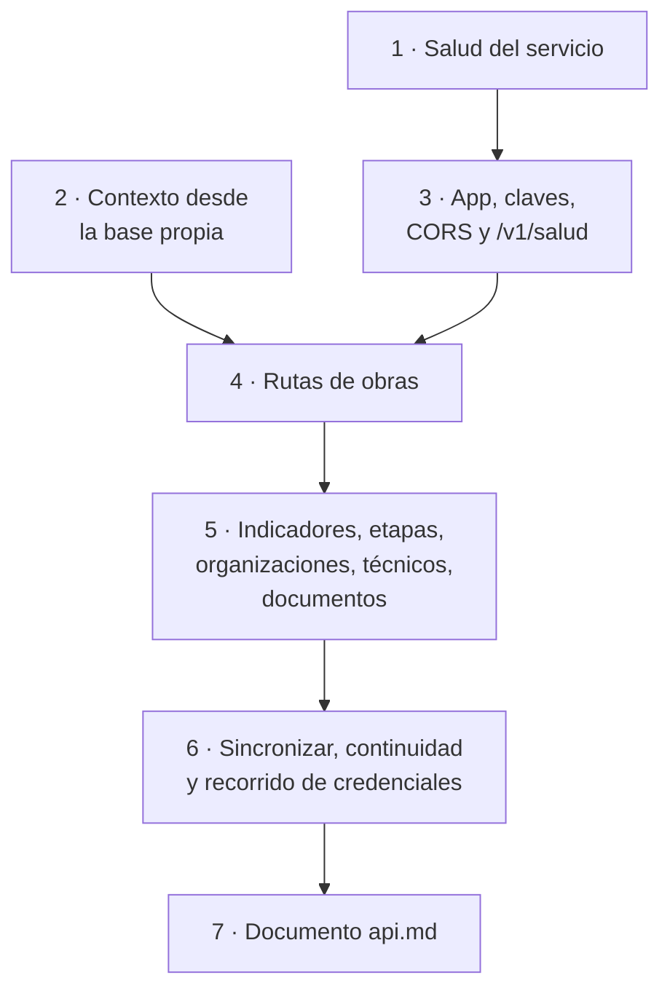
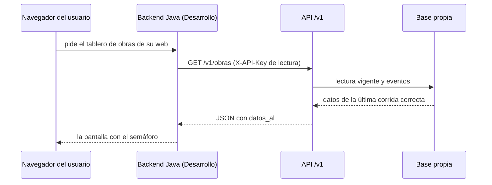

# Plan 4 · API `/v1`

> **Para quien lo ejecuta (persona o agente):** seguí las tareas en orden y marcá cada casilla `- [ ]`. Si tu agente
> tiene las skills de superpowers, usá `superpowers:subagent-driven-development` (recomendado) o
> `superpowers:executing-plans`. Leé antes `../LEEME.md` y las secciones 2 (decisiones 2 y 19), 10 y 11 de
> `../especificacion.md`.

**Objetivo:** publicar los datos del servicio en una API JSON de solo lectura, con claves, para nuestro tablero y para
el sistema de Desarrollo, que responda siempre desde la base propia aunque el origen esté caído.

**Arquitectura:** FastAPI con una fábrica `crear_app(...)`. Cada pedido arma (o toma de un caché) el `Contexto` desde
la base propia con `instantanea` (Plan 2) y responde con las funciones de `analitica.respuestas` (Plan 3): la API no
calcula nada propio, solo valida claves, filtra y serializa. `analitica/salud.py` calcula el estado del servicio y lo
usan la API y el comando `salud` del Plan 6.

**Tecnología:** FastAPI, Uvicorn, SQLAlchemy (de la base propia); pytest con `fastapi.testclient.TestClient` y SQLite
en carpetas temporales.

**Especificación:** `../especificacion.md`, secciones 10 (rutas, claves, CORS) y 11 (variables), criterios 5 y 6 de la
Etapa 6.

**Depende de:** el Plan 2 (`base_de_datos`, `sincronizador`, `instantanea`) y el Plan 3 (`indicadores.contexto`,
`respuestas`). **Lo necesitan:** el modo API del tablero (Plan 5) y el despliegue (Plan 6).

## Restricciones globales

- Python 3.13 con `.venv`; comandos de PowerShell desde `vivso-analitica/`; todo en español (también los mensajes de
  error de la API).
- **La API nunca consulta el origen**, salvo `POST /v1/sincronizar`. Toda respuesta lleva `datos_al`.
- Claves en el encabezado `X-API-Key`, comparadas con `secrets.compare_digest`. Sin clave → 401; clave de lectura en una
  ruta de administración → 403; sin claves configuradas, todo responde 401 salvo `/v1/salud`.
- Ninguna respuesta tiene campos con `token`, `password`, `contrasena`, `clave`, `secret` o `hash` en el nombre; de las
  familias, solo conteos (prueba de recorrido, Tarea 6).
- CORS solo para los orígenes de `ANALITICA_CORS_ORIGENES`.
- El núcleo (`analitica/` salvo `analitica/api/`) no importa `fastapi`; la prueba
  `test_el_nucleo_no_carga_fastapi_ni_streamlit` lo controla.
- Documentos sin «Plan N», «Claude», «superpowers» ni el host de Aiven; diagramas Mermaid 11.
- Commits en español, sin coautoría ni menciones a IA; suite completa en verde antes de cada commit.

## Foco de revisión

1. **El origen se cae después de varias corridas correctas:** `GET /v1/obras` sigue respondiendo con los datos viejos y
   `GET /v1/salud` dice cuánto hace de la última corrida correcta (criterio 6).
2. **Dos pedidos simultáneos con el caché vacío:** no puede quedar un `Contexto` a medias; usar un candado
   (`threading.Lock`) alrededor del cálculo.
3. **Un `id` que no existe o no es número** (`/v1/obras/abc`, `/v1/obras/999999`): 422 y 404 con un mensaje en
   español, nunca 500.
4. **Una base con datos de otro origen** (por ejemplo, simulados con `ANALITICA_ORIGEN=mysql`): la API muestra solo los
   del origen configurado (nada, en ese caso) y `salud` dice `sin_datos`.
5. **Claves con espacios o vacías en el `.env`:** `config` ya las limpia; una clave vacía no habilita nada.

## Mapa



Quién consulta la API:



## Archivos

| Archivo | Responsabilidad |
| :--- | :--- |
| `analitica/salud.py` | Estado del servicio |
| `analitica/api/__init__.py` | Vacío |
| `analitica/api/dependencias.py` | Motor, sesión, calendario y `Contexto` desde la base (con caché) |
| `analitica/api/seguridad.py` | Claves de lectura y de administración |
| `analitica/api/app.py` | `crear_app()` y `app` |
| `analitica/api/rutas.py` | Las rutas `/v1` |
| `analitica/__main__.py` | Comando `api` |
| `docs/api.md` | Documento para el equipo de Desarrollo |

---

### Tarea 1: Salud del servicio

**Archivos:** `requirements.txt`, `analitica/salud.py`, `tests/test_salud.py`

**Interfaces:**
- `ESTADOS_SALUD = ("ok", "degradado", "desactualizado", "sin_datos")`
- `estado_de_salud(sesion: Session, origen: str, ahora: datetime, intervalo_min: int) -> dict` con `estado`, `origen`,
  `ultima_corrida` (ISO o `None`), `resultado_ultima_corrida`, `ultima_corrida_ok` (ISO o `None`), `datos_al` (=
  `ultima_corrida_ok`), `minutos_desde_ok` (entero o `None`). Reglas: sin corrida correcta de ese origen → `sin_datos`;
  `minutos_desde_ok >= 1440` → `desactualizado`; `> 2 × intervalo_min` → `degradado`; si no, `ok`.

- [ ] **Paso 1:** sumar `fastapi` y `uvicorn` a `requirements.txt`, instalar y fijar con `==` las versiones instaladas.
- [ ] **Paso 2: pruebas que fallan:**

```python
@pytest.mark.parametrize("minutos, esperado", [(10, "ok"), (60, "ok"), (61, "degradado"), (1439, "degradado"), (1440, "desactualizado")])
def test_estado_segun_la_ultima_corrida_correcta(sesion, minutos, esperado):
    sesion.add(Corrida(origen="simulado", inicio=datetime(2026, 11, 4, 8), fin=datetime(2026, 11, 4, 8), resultado="ok", detalle={}))
    sesion.commit()
    salud = estado_de_salud(sesion, "simulado", datetime(2026, 11, 4, 8) + timedelta(minutes=minutos), intervalo_min=30)
    assert salud["estado"] == esperado and salud["datos_al"] == "2026-11-04T08:00:00"


def test_sin_corridas_o_de_otro_origen(sesion):
    assert estado_de_salud(sesion, "mysql", datetime(2026, 11, 4), 30)["estado"] == "sin_datos"


def test_las_corridas_con_error_no_cuentan(sesion):
    sesion.add_all([Corrida(origen="simulado", inicio=datetime(2026, 11, 4, 8), fin=datetime(2026, 11, 4, 8), resultado="ok", detalle={}),
                    Corrida(origen="simulado", inicio=datetime(2026, 11, 4, 9), fin=datetime(2026, 11, 4, 9), resultado="error", detalle={})])
    sesion.commit()
    salud = estado_de_salud(sesion, "simulado", datetime(2026, 11, 4, 9, 10), 30)
    assert (salud["estado"], salud["resultado_ultima_corrida"], salud["minutos_desde_ok"]) == ("degradado", "error", 70)
```

- [ ] **Pasos 3 a 5:** correr, implementar, suite en verde.
- [ ] **Paso 6: commit** `"Calcular el estado de salud del servicio"`.

### Tarea 2: Contexto desde la base propia

**Archivos:** `analitica/api/dependencias.py`, `tests/test_api_contexto.py`

**Interfaces:**
- `contexto_desde_base(sesion: Session, origen: str, calendario: Calendario) -> Contexto`:
  `lectura = instantanea.lectura_vigente(sesion, origen)`, `eventos_guardados = instantanea.eventos_guardados(...)`,
  `hoy` = fecha de la última corrida correcta (o `ahora_local().date()` si no hay), y
  `indicadores.contexto.contexto_desde_lectura(lectura, calendario, hoy, eventos_guardados)`.
- `CacheDeContexto` con `obtener(sesion, origen, calendario) -> Contexto`: recalcula solo si cambió el `id` de la última
  corrida correcta de ese origen; protegido con un `threading.Lock`; `invalidar()`.
- `calendario_para(cfg: Configuracion, hoy: date) -> Calendario`: `calendario_de_indicadores(cfg, range(2025, hoy.year + 2))`
  (los años con obras simuladas y el siguiente).

- [ ] **Paso 1: pruebas que fallan:**

```python
def test_el_contexto_de_la_base_calcula_lo_mismo_que_la_lectura(sesion):
    lectura = OrigenSimulado(8, hasta=date(2026, 10, 15)).leer()
    sincronizar(OrigenFijo(lectura), sesion, datetime(2026, 10, 15, 23, 59, 59))
    desde_base = contexto_desde_base(sesion, "simulado", Calendario())
    directo = contexto_desde_lectura(lectura, Calendario())
    assert respuesta_obras(desde_base)["obras"] == respuesta_obras(directo)["obras"]


def test_el_cache_se_renueva_con_cada_corrida_correcta(sesion):
    mundo = OrigenSimulado(8)
    cache = CacheDeContexto()
    sincronizar(mundo.al_corte(datetime(2026, 10, 1)), sesion, datetime(2026, 10, 1))
    primero = cache.obtener(sesion, "simulado", Calendario())
    assert cache.obtener(sesion, "simulado", Calendario()) is primero
    sincronizar(mundo.al_corte(datetime(2026, 10, 15)), sesion, datetime(2026, 10, 15))
    assert cache.obtener(sesion, "simulado", Calendario()).hoy == date(2026, 10, 15)
```

- [ ] **Pasos 2 a 4:** correr, implementar, suite en verde.
- [ ] **Paso 5: commit** `"Armar el contexto de cálculo desde la base propia, con caché"`.

### Tarea 3: App, claves, CORS y `/v1/salud`

**Archivos:** `analitica/api/app.py`, `analitica/api/seguridad.py`, `analitica/api/rutas.py`, `tests/test_api.py`

**Interfaces:**
- `crear_app(cfg: Configuracion | None = None, motor: Engine | None = None, calendario: Calendario | None = None) -> FastAPI`:
  sin `cfg`, `cargar_configuracion()`; sin `motor`, `crear_motor(cfg.db_url)` + `crear_tablas`; sin `calendario`,
  `calendario_para(cfg, ...)` la primera vez que se necesite. Título «API de analítica de VIVSO», versión «1», `/docs`
  activa. `app = crear_app()` a nivel de módulo solo cuando se importa `analitica.api.app` (para `uvicorn`).
- `seguridad.exigir_lectura` y `seguridad.exigir_admin`: dependencias de FastAPI. Lectura acepta la clave de lectura o la
  de administración. Mensajes: 401 «Falta la clave en el encabezado X-API-Key» / «La clave no es válida» / «La API no
  tiene claves configuradas»; 403 «Esta ruta necesita la clave de administración».
- CORS con `CORSMiddleware`: `allow_origins = cfg.cors_origenes`, métodos `GET` y `POST`, encabezado `X-API-Key`.
- `GET /v1/salud` (sin clave): `estado_de_salud(...)` con `ahora_local()` y `cfg.intervalo_min`; nada de datos de obras.
- Fixture de pruebas `cliente_api` (en `tests/conftest.py`, porque la usa también el tablero del Plan 5): un
  `TestClient(crear_app(cfg, motor, Calendario()))` con
  `cfg = cargar_configuracion({"ANALITICA_CLAVE_LECTURA": "lectura-1", "ANALITICA_CLAVE_ADMIN": "admin-1",
  "ANALITICA_CORS_ORIGENES": "https://vivso.ejemplo.gob.ar", "ANALITICA_DB_URL": "sqlite:///<tmp>/a.db"})` y una
  corrida ya sincronizada: `sincronizar(OrigenSimulado(8).al_corte(date(2026, 10, 15)), sesion,
  datetime(2026, 10, 15, 23, 59, 59))` (así `datos_al` es `"2026-10-15T23:59:59"`).

- [ ] **Paso 1: pruebas que fallan:**

```python
def test_salud_sin_clave(cliente_api):
    respuesta = cliente_api.get("/v1/salud")
    assert respuesta.status_code == 200 and respuesta.json()["origen"] == "simulado"
    assert "obras" not in respuesta.json()


@pytest.mark.parametrize("encabezados, codigo", [({}, 401), ({"X-API-Key": "otra"}, 401), ({"X-API-Key": "lectura-1"}, 200),
                                                 ({"X-API-Key": "admin-1"}, 200)])
def test_claves_de_lectura(cliente_api, encabezados, codigo):
    assert cliente_api.get("/v1/obras", headers=encabezados).status_code == codigo


def test_la_clave_de_lectura_no_administra(cliente_api):
    respuesta = cliente_api.post("/v1/sincronizar", headers={"X-API-Key": "lectura-1"})
    assert respuesta.status_code == 403 and "administración" in respuesta.json()["detail"]


def test_sin_claves_configuradas_todo_cerrado_salvo_salud(tmp_path):
    cliente = TestClient(crear_app(cargar_configuracion({"ANALITICA_DB_URL": f"sqlite:///{tmp_path / 'b.db'}"}),
                                   calendario=Calendario()))
    assert cliente.get("/v1/salud").status_code == 200
    assert cliente.get("/v1/obras", headers={"X-API-Key": ""}).status_code == 401


def test_cors(cliente_api):
    permitido = cliente_api.options("/v1/obras", headers={"Origin": "https://vivso.ejemplo.gob.ar",
                                                          "Access-Control-Request-Method": "GET"})
    assert permitido.headers.get("access-control-allow-origin") == "https://vivso.ejemplo.gob.ar"
    rechazado = cliente_api.options("/v1/obras", headers={"Origin": "https://otro.sitio", "Access-Control-Request-Method": "GET"})
    assert "access-control-allow-origin" not in rechazado.headers
```

- [ ] **Pasos 2 a 4:** correr, implementar, suite en verde. Ajustar `test_el_nucleo_no_carga_fastapi_ni_streamlit` si
  hace falta para que siga controlando todo menos `analitica.api`.
- [ ] **Paso 5: commit** `"Crear la API con claves, CORS y estado de salud"`.

### Tarea 4: Rutas de obras

**Archivos:** `analitica/api/rutas.py`, `tests/test_api.py`

**Interfaces** (todas con `exigir_lectura`; responden lo de `analitica.respuestas`):
- `GET /v1/obras?semaforo=&cuit=&grupo=&departamento=&tipo_vivienda=` → `respuesta_obras(ctx, ...)`. Un `semaforo`
  que no está en `SEMAFOROS`, o un `grupo` que no es `OG` ni `ONG`, → 422 con la lista de valores válidos.
- `GET /v1/obras/{id_solicitud}` (entero) → `respuesta_ficha`; 404 «No hay una obra con ese número de solicitud».
- `GET /v1/obras/{id_solicitud}/linea-de-tiempo` → `respuesta_linea_de_tiempo`; 404 igual.

- [ ] **Paso 1: pruebas que fallan:**

```python
LECTURA = {"X-API-Key": "lectura-1"}

def test_obras_y_filtros(cliente_api):
    todas = cliente_api.get("/v1/obras", headers=LECTURA).json()
    assert todas["datos_al"] == "2026-10-15T23:59:59" and todas["total"] == len(todas["obras"]) > 0
    vencidas = cliente_api.get("/v1/obras", params={"semaforo": "vencida"}, headers=LECTURA).json()
    assert all(o["semaforo"] == "vencida" for o in vencidas["obras"])
    assert cliente_api.get("/v1/obras", params={"semaforo": "rojo"}, headers=LECTURA).status_code == 422


def test_ficha_y_linea_de_tiempo(cliente_api):
    id_obra = cliente_api.get("/v1/obras", headers=LECTURA).json()["obras"][0]["id_solicitud"]
    ficha = cliente_api.get(f"/v1/obras/{id_obra}", headers=LECTURA).json()
    assert ficha["solicitud"]["id_solicitud"] == id_obra and len(ficha["etapas"]) == 6
    linea = cliente_api.get(f"/v1/obras/{id_obra}/linea-de-tiempo", headers=LECTURA).json()
    assert linea["eventos"] and linea["eventos"] == sorted(linea["eventos"], key=lambda e: e["momento"])
    assert cliente_api.get("/v1/obras/999999", headers=LECTURA).status_code == 404
    assert cliente_api.get("/v1/obras/abc", headers=LECTURA).status_code == 422
```

- [ ] **Pasos 2 a 4:** correr, implementar, suite en verde.
- [ ] **Paso 5: commit** `"Publicar las obras, su ficha y su línea de tiempo"`.

### Tarea 5: Indicadores, etapas, organizaciones, técnicos y documentos

**Archivos:** `analitica/api/rutas.py`, `tests/test_api.py`

**Interfaces** (con `exigir_lectura`): `GET /v1/indicadores` → `respuesta_indicadores`; `GET /v1/indicadores/{codigo}`
→ `respuesta_indicador` (404 si el código no está en el catálogo, con la lista de códigos); `GET /v1/etapas/resumen`;
`GET /v1/organizaciones`; `GET /v1/organizaciones/{cuit}` (404 si no existe); `GET /v1/tecnicos`;
`GET /v1/documentos/resumen`.

- [ ] **Paso 1: pruebas que fallan:**

```python
def test_indicadores(cliente_api):
    todos = cliente_api.get("/v1/indicadores", headers=LECTURA).json()["indicadores"]
    assert [i["codigo"] for i in todos] == list(CATALOGO)
    uno = cliente_api.get("/v1/indicadores/prorrogas", headers=LECTURA).json()
    assert uno["codigo"] == "prorrogas" and uno["pregunta"] and "datos_al" in uno
    assert cliente_api.get("/v1/indicadores/no_existe", headers=LECTURA).status_code == 404


@pytest.mark.parametrize("ruta, clave", [("/v1/etapas/resumen", "etapas"), ("/v1/organizaciones", "organizaciones"),
                                         ("/v1/tecnicos", "tecnicos"), ("/v1/documentos/resumen", "codigo")])
def test_resumenes(cliente_api, ruta, clave):
    respuesta = cliente_api.get(ruta, headers=LECTURA)
    assert respuesta.status_code == 200 and clave in respuesta.json()
```

- [ ] **Pasos 2 a 4:** correr, implementar, suite en verde.
- [ ] **Paso 5: commit** `"Publicar los indicadores y los resúmenes por etapa, organización, técnico y documento"`.

### Tarea 6: Sincronizar desde la API, continuidad y recorrido de credenciales

**Archivos:** `analitica/api/rutas.py`, `analitica/__main__.py`, `tests/test_api.py`, `tests/test_api_seguridad.py`

**Interfaces:**
- `POST /v1/sincronizar` (con `exigir_admin`): corre `sincronizar(crear_origen(cfg.origen), sesion, ahora_local())`,
  invalida el caché y devuelve el `ResultadoCorrida` como JSON (código 200 aunque la corrida dé `error`: el error está
  en el cuerpo). La app guarda una función `app.state.crear_origen` (por defecto `crear_origen`) para poder
  reemplazarla en las pruebas.
- `python -m analitica api [--puerto 8000]`: corre `uvicorn analitica.api.app:app` en `127.0.0.1` (en Docker se usa
  `0.0.0.0` desde el `docker-compose.yml`).

- [ ] **Paso 1: pruebas que fallan:**

```python
def test_con_el_origen_caido_la_api_sigue_respondiendo(cliente_api):
    cliente_api.app.state.crear_origen = lambda codigo: OrigenQueFalla("simulado")
    corrida = cliente_api.post("/v1/sincronizar", headers={"X-API-Key": "admin-1"}).json()
    assert corrida["resultado"] == "error"
    obras = cliente_api.get("/v1/obras", headers=LECTURA)
    assert obras.status_code == 200 and obras.json()["datos_al"] == "2026-10-15T23:59:59"
    salud = cliente_api.get("/v1/salud").json()
    assert salud["resultado_ultima_corrida"] == "error" and salud["datos_al"] == "2026-10-15T23:59:59"


PROHIBIDAS = re.compile(r"token|password|contrasena|clave|secret|hash", re.I)

def _claves(valor):
    if isinstance(valor, dict):
        for clave, interno in valor.items():
            yield clave
            yield from _claves(interno)
    elif isinstance(valor, list):
        for interno in valor:
            yield from _claves(interno)


def test_ninguna_respuesta_tiene_credenciales_ni_datos_de_familia(cliente_api):
    id_obra = cliente_api.get("/v1/obras", headers=LECTURA).json()["obras"][0]["id_solicitud"]
    cuit = cliente_api.get("/v1/organizaciones", headers=LECTURA).json()["organizaciones"][0]["cuit"]
    rutas = [r.path.format(id_solicitud=id_obra, cuit=cuit, codigo="afo") for r in cliente_api.app.routes
             if getattr(r, "methods", None) == {"GET"} and r.path.startswith("/v1")]
    assert len(rutas) >= 11
    for ruta in rutas:
        cuerpo = cliente_api.get(ruta, headers=LECTURA).json()
        assert not [c for c in _claves(cuerpo) if PROHIBIDAS.search(c)], ruta
    ficha = cliente_api.get(f"/v1/obras/{id_obra}", headers=LECTURA).json()
    assert set(ficha["familia"]) == {"id_familia", "cantidad_familiares", "antiguedad_rancho"}
```

- [ ] **Pasos 2 a 4:** correr, implementar, suite en verde.
- [ ] **Paso 5:** probar a mano: `.venv\Scripts\python.exe -m analitica sincronizar`, después
  `.venv\Scripts\python.exe -m analitica api` y abrir `http://127.0.0.1:8000/docs` (con las claves en el `.env`).
- [ ] **Paso 6: commit** `"Sincronizar desde la API y garantizar continuidad y credenciales fuera de las respuestas"`.

### Tarea 7: Documento `docs/api.md`

**Archivos:** `docs/api.md`, `docs/README.md`, `README.md`, `docs/pedido-a-desarrollo.md`, `tests/test_documentos.py`

Contenido, para el equipo de Desarrollo (técnico pero claro):

1. Qué es la API y qué no hace (solo lee; responde desde la base propia; `datos_al` en todo).
2. Claves: cómo pedirlas, dónde ponerlas (`X-API-Key`), por qué la consulta tiene que ir de servidor a servidor (una
   clave en un navegador queda a la vista) y la clave de administración.
3. Tabla de rutas (método, ruta, clave, qué devuelve, filtros) y un ejemplo de respuesta recortado de `/v1/obras` y de
   `/v1/salud`, generados con el simulado (sin datos reales).
4. Ejemplos de uso: `curl` y un ejemplo en Java (`RestClient` de Spring o `HttpClient`) para llamar a `/v1/obras` desde
   su backend.
5. Códigos de error (401, 403, 404, 422) y el estado de salud (`ok`, `degradado`, `desactualizado`, `sin_datos`).
6. Diagramas: el de secuencia de este plan y uno de las claves (`flowchart` de la decisión 401/403/200).

- [ ] **Paso 1:** sumar `"docs/api.md": 2` a `DIAGRAMAS_MINIMOS`; correr → falla.
- [ ] **Paso 2:** escribir; sumar al índice y al README; en `pedido-a-desarrollo.md`, en «Lo que ofrecemos», enlazar
  `api.md`.
- [ ] **Paso 3:** revisar los diagramas; releer como alguien de Desarrollo; suite en verde.
- [ ] **Paso 4: commit** `"Documentar la API para el equipo de Desarrollo"`.

---

## Decisiones para tomar al revisar

1. **Una o varias claves de lectura:** una por consumidor (tablero, backend de Desarrollo) permite cortar una sin
   afectar a la otra; la especificación prevé una sola (recomendado: una sola para PP3, varias como mejora).
2. **Paginación de `/v1/obras`:** no hace falta con cientos de obras (recomendado: sin paginar, anotarlo como mejora).
