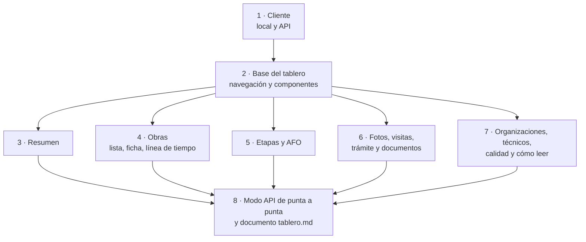
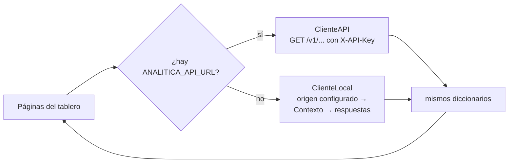

# Plan 5 · Tablero

> **Para quien lo ejecuta (persona o agente):** seguí las tareas en orden y marcá cada casilla `- [ ]`. Si tu agente
> tiene las skills de superpowers, usá `superpowers:subagent-driven-development` (recomendado) o
> `superpowers:executing-plans`; si tiene una skill de visualización de datos (por ejemplo `dataviz`) o de diseño de
> interfaces, usala para los gráficos y la disposición. Leé antes `../LEEME.md` y las secciones 9, 12 y la decisión 6 de
> `../especificacion.md`.

**Objetivo:** un tablero Streamlit para el área y para Desarrollo que muestre, en lenguaje llano, el estado de cada obra
(semáforo, AFO, línea de tiempo) y los 17 indicadores, y que funcione igual consumiendo la API o calculando en el mismo
proceso.

**Arquitectura:** `tablero/cliente.py` define una interfaz `Cliente` con dos implementaciones: `ClienteAPI` (consume
`/v1` con `httpx`) y `ClienteLocal` (arma el `Contexto` desde el origen configurado y llama a `analitica.respuestas`).
Las dos devuelven los mismos diccionarios, así las páginas no saben de dónde vienen los datos. Cada página es un archivo
de `tablero/paginas/` que se puede correr y probar solo; `tablero/app.py` las reúne con `st.navigation`.

**Tecnología:** Streamlit (con Altair, que trae incluido), httpx, pandas; pruebas con `streamlit.testing.v1.AppTest` y
`httpx.MockTransport`.

**Especificación:** `../especificacion.md`, secciones 9 (qué dice cada indicador) y 12 (páginas y modos), decisión 6
(origen vacío) y criterio 8 de la Etapa 6 (utilidad).

**Depende de:** el Plan 3 (`respuestas`, `indicadores.contexto`, `obras.SEMAFOROS`). El modo API (Tarea 8) necesita
además el Plan 4. Se puede empezar cuando el Plan 3 tenga la Tarea 13 hecha; mientras tanto se pueden armar la base y
los componentes contra respuestas de ejemplo.

## Restricciones globales

- Python 3.13 con `.venv`; comandos de PowerShell desde `vivso-analitica/`; **todo el texto del tablero en español y
  en lenguaje llano** (sin «API», «dataset», «backend» sin explicar; el profesor pidió orientarlo al público general).
- Con el origen simulado, un aviso visible en todas las páginas: «Datos simulados: sirven para mostrar cómo funciona,
  no describen el programa real». Con el origen vacío, cada página muestra «Todavía no hay datos» en vez de un error.
- Nunca se muestran tokens ni contraseñas; de las familias, solo la cantidad de familiares y la antigüedad del rancho.
  Con datos reales, el tablero corre solo con acceso restringido (Plan 6); **la demo pública usa siempre el simulado**.
- El semáforo usa colores **y** texto (no solo color), con buen contraste en modo claro y oscuro.
- El paquete `analitica` (núcleo) no importa `streamlit`; solo `tablero/` lo hace.
- Ninguna prueba usa la red (el modo API se prueba con `httpx.MockTransport`).
- Documentos sin «Plan N», «Claude», «superpowers» ni el host de Aiven; diagramas Mermaid 11.
- Commits en español, sin coautoría ni menciones a IA; suite completa en verde antes de cada commit.

## Foco de revisión

1. **La API no responde o rechaza la clave:** la página muestra un mensaje claro («No se pudo consultar el servicio:
   la clave no es válida») y no una traza de Python.
2. **Una obra sin vivienda completa, sin visita o sin fotos:** la ficha muestra «sin datos» en esas partes, sin errores.
3. **Filtros que dejan la tabla vacía:** «Ninguna obra cumple esos filtros», no una tabla vacía sin explicación.
4. **El caché de Streamlit entre modos:** cambiar `ANALITICA_ORIGEN` y recargar tiene que cambiar los datos (el caché se
   indexa por la configuración).
5. **Pantallas chicas:** las tablas largas se pueden desplazar y los gráficos usan el ancho del contenedor.

## Mapa



Los dos modos del tablero:



## Archivos

| Archivo | Responsabilidad |
| :--- | :--- |
| `tablero/__init__.py` | Vacío |
| `tablero/cliente.py` | `Cliente`, `ClienteLocal`, `ClienteAPI`, `crear_cliente`, `ErrorDelCliente` |
| `tablero/estado.py` | `obtener_cliente()` y `obtener_salud()` con caché de Streamlit |
| `tablero/componentes.py` | Aviso de origen, estado vacío, tarjeta de indicador, colores del semáforo, tablas |
| `tablero/app.py` | Navegación entre páginas |
| `tablero/paginas/*.py` | Una página por archivo (11) |
| `.streamlit/config.toml` | Tema y título |
| `docs/tablero.md` | Guía de lectura para el área |

---

### Tarea 1: Cliente local y cliente de la API

**Archivos:** `requirements.txt`, `tablero/__init__.py`, `tablero/cliente.py`, `tests/test_tablero_cliente.py`

**Interfaces:**
- `ErrorDelCliente(Exception)` con un mensaje en español listo para mostrar.
- `Cliente` (Protocol), métodos: `salud() -> dict`, `obras(**filtros) -> dict`, `ficha(id_solicitud: int) -> dict | None`,
  `linea_de_tiempo(id_solicitud: int) -> dict | None`, `indicadores() -> dict`, `indicador(codigo: str) -> dict | None`,
  `etapas_resumen() -> dict`, `organizaciones() -> dict`, `organizacion(cuit: str) -> dict | None`, `tecnicos() -> dict`,
  `documentos_resumen() -> dict`; atributo `modo` (`"local"` o `"api"`).
- `ClienteLocal(origen: Origen, calendario: Calendario)`: lee una vez (`origen.leer()`), arma el `Contexto` con
  `contexto_desde_lectura` y responde con `analitica.respuestas`; `salud()` devuelve `{"estado": "ok" o "sin_datos",
  "origen", "datos_al", "modo": "local"}`.
- `ClienteAPI(url: str, clave: str | None, cliente_http: httpx.Client | None = None)`: `GET {url}/v1/...` con
  `X-API-Key`, tiempo de espera 20 s; 404 → `None`; 401/403 → `ErrorDelCliente("La clave del tablero no es válida o
  no tiene permiso")`; otros errores o sin conexión → `ErrorDelCliente("No se pudo consultar el servicio: …")`.
- `crear_cliente(cfg: Configuracion | None = None) -> Cliente`: con `cfg.api_url`, `ClienteAPI(cfg.api_url,
  cfg.clave_lectura)`; si no, `ClienteLocal(crear_origen(cfg.origen), calendario_de_indicadores(cfg, ...)[0])`.

- [ ] **Paso 1:** sumar `streamlit` a `requirements.txt`, instalar y fijar con `==`.
- [ ] **Paso 2: pruebas que fallan:**

```python
@pytest.fixture(scope="module")
def local():
    return ClienteLocal(OrigenSimulado(8, hasta=date(2026, 10, 15)), Calendario())


def test_el_cliente_local_responde_como_la_api(local):
    obras = local.obras()
    assert obras["origen"] == "simulado" and obras["total"] > 0
    assert local.ficha(obras["obras"][0]["id_solicitud"])["solicitud"]
    assert local.ficha(999999) is None and local.salud()["modo"] == "local"


def test_el_cliente_api_usa_la_clave_y_traduce_errores(local):
    def responder(pedido):
        if pedido.headers.get("X-API-Key") != "lectura-1":
            return httpx.Response(401, json={"detail": "La clave no es válida"})
        if pedido.url.path == "/v1/obras":
            return httpx.Response(200, json=local.obras())
        return httpx.Response(404, json={"detail": "no"})
    http = httpx.Client(transport=httpx.MockTransport(responder), base_url="http://servicio")
    assert ClienteAPI("http://servicio", "lectura-1", http).obras() == local.obras()
    assert ClienteAPI("http://servicio", "lectura-1", http).ficha(1) is None
    with pytest.raises(ErrorDelCliente, match="clave"):
        ClienteAPI("http://servicio", "otra", http).obras()


def test_crear_cliente_segun_la_configuracion():
    assert crear_cliente(cargar_configuracion({"ANALITICA_ORIGEN": "vacio"})).modo == "local"
    assert crear_cliente(cargar_configuracion({"ANALITICA_API_URL": "http://servicio"})).modo == "api"
```

  (`crear_cliente` con origen `vacio` no debe bajar feriados: si `calendario_de_indicadores` intentara la red, la
  prueba falla por `conftest.py`. Con origen vacío, usar un `Calendario()` sin feriados.)
- [ ] **Pasos 3 a 5:** correr, implementar, suite en verde.
- [ ] **Paso 6: commit** `"Crear el cliente del tablero: local o contra la API"`.

### Tarea 2: Base del tablero (navegación, estado y componentes)

**Archivos:** `tablero/app.py`, `tablero/estado.py`, `tablero/componentes.py`, `tablero/paginas/resumen.py` (un esqueleto
que la Tarea 3 completa), `.streamlit/config.toml`, `tests/test_tablero_paginas.py`

**Interfaces:**
- `estado.obtener_cliente() -> Cliente`: `@st.cache_resource` con la configuración (`repr(cargar_configuracion())`,
  que no muestra claves) como argumento, así cambia si cambia el `.env`.
- `estado.obtener_salud() -> dict` (sin caché: es barata).
- `componentes.COLORES_SEMAFORO: dict[str, str]` (un color por código de `SEMAFOROS`, con contraste suficiente sobre
  fondo claro y oscuro; verde para `en_plazo` y `terminada`, ámbar para `por_vencer`, `esperando_tecnico` y
  `revision_demorada`, rojo para las vencidas y gris oscuro para `rechazada`).
- `componentes.aviso_de_origen(salud: dict) -> None`: aviso de datos simulados; aviso de datos desactualizados o
  degradados con los minutos desde la última corrida correcta; y «Datos al: …» siempre.
- `componentes.estado_vacio(mensaje="Todavía no hay datos") -> None`.
- `componentes.tarjeta_indicador(indicador: dict) -> None`: título, pregunta, etiquetas de confianza y capacidad (con su
  explicación en un `help`), el `resumen` como métricas, las `tablas` como `st.dataframe` con nombres de columna
  legibles (guiones bajos → espacios, primera letra en mayúscula), las `notas` como avisos, y un desplegable «Cómo
  leerlo» con `explicacion` y `como_leerlo`.
- `componentes.mostrar_error(error: ErrorDelCliente) -> None`.
- `app.py`: `st.set_page_config(page_title="Analítica de VIVSO", layout="wide")` y `st.navigation` con las 11 páginas
  en este orden: Resumen, Obras, Etapas, Avance de obra (AFO), Evidencia en fotos, Visitas iniciales, Trámite y
  documentos, Organizaciones, Técnicos, Calidad de los datos, Cómo leer este tablero.
- Cada página: llama a `obtener_salud()`, muestra `aviso_de_origen`, y si `salud["estado"] == "sin_datos"` muestra
  `estado_vacio()` y termina; atrapa `ErrorDelCliente` con `mostrar_error`.

- [ ] **Paso 1: pruebas que fallan** (`tests/test_tablero_paginas.py`; la lista `PAGINAS` crece con cada tarea):

```python
PAGINAS = ["tablero/paginas/resumen.py"]

@pytest.fixture(autouse=True)
def sin_red_ni_cache(monkeypatch):
    # Los feriados se bajarían de internet: en las pruebas, un calendario sin feriados.
    monkeypatch.setattr("tablero.cliente.calendario_de_indicadores", lambda cfg, anios: (Calendario(), []))
    yield
    st.cache_resource.clear()


@pytest.mark.parametrize("pagina", PAGINAS)
def test_cada_pagina_con_el_simulado(pagina):
    at = AppTest.from_file(pagina, default_timeout=120).run()
    assert not at.exception
    assert any("Datos simulados" in w.value for w in at.warning)


@pytest.mark.parametrize("pagina", PAGINAS)
def test_cada_pagina_con_el_origen_vacio(pagina, monkeypatch):
    monkeypatch.setenv("ANALITICA_ORIGEN", "vacio")
    at = AppTest.from_file(pagina).run()
    assert not at.exception and any("Todavía no hay datos" in i.value for i in at.info)


def test_la_app_arranca():
    assert not AppTest.from_file("tablero/app.py", default_timeout=120).run().exception
```

  `estado.py` importa `crear_cliente` con `from tablero.cliente import crear_cliente` (así las pruebas pueden
  reemplazarlo en `tablero.estado`), y `tablero/cliente.py` importa `calendario_de_indicadores` por nombre (así las
  pruebas lo reemplazan en `tablero.cliente`).
- [ ] **Pasos 2 a 4:** correr, implementar, suite en verde.
- [ ] **Paso 5:** mirarlo: `.venv\Scripts\python.exe -m streamlit run tablero/app.py`.
- [ ] **Paso 6: commit** `"Armar la base del tablero: navegación, avisos y tarjetas de indicadores"`.

### Tareas 3 a 7: las páginas

Cada página se suma a `PAGINAS` en `tests/test_tablero_paginas.py` (así queda probada con el simulado y con el origen
vacío) y, además, tiene su prueba propia con lo que tiene que aparecer. Pasos de cada tarea: (1) sumar la página a
`PAGINAS` y escribir su prueba propia; (2) correr → falla; (3) implementar; (4) mirarla con `streamlit run` en modo
claro y oscuro, y en una ventana angosta; (5) suite en verde; (6) commit con el mensaje de la tarea.

| Tarea · página | Qué muestra (datos del cliente) | Prueba propia | Commit |
| :--- | :--- | :--- | :--- |
| 3 · `resumen.py` | Métricas: obras en curso, vencidas (las tres clases), por vencer, terminadas, rechazadas, AFO mediano (de `indicador("semaforo_obras")` y `indicador("afo")`); un gráfico de barras del semáforo con sus colores y su texto; «Las 10 obras más atrasadas» (de `obras()`, por `brecha_habiles`); un párrafo de qué es VIVSO y qué mide este tablero | aparecen las métricas «Obras vencidas» y «AFO mediano» y una tabla con 10 filas | `"Página de resumen del tablero"` |
| 4 · `obras.py` | Filtros (semáforo, grupo, organización, departamento, tipo de vivienda) que pasan a `obras(...)`; la tabla con el semáforo coloreado y en texto; al elegir una obra (selector por número de expediente), su ficha en pestañas: Resumen (datos, organización y grupo, familia en conteos, vivienda, técnico), Etapas (tabla de las 6 con estado y fechas; AFO contra plan en barras), Línea de tiempo (tabla y un gráfico de puntos por fecha y tipo, con la precisión en el tooltip), Fotos y Documentos (listas con fechas; sin abrir archivos) | con el simulado aparece la tabla; al elegir la primera obra, la pestaña «Línea de tiempo» tiene filas; con un filtro sin resultados aparece «Ninguna obra cumple esos filtros» | `"Página de obras con su ficha y su línea de tiempo"` |
| 5 · `etapas.py` y `afo.py` | Etapas: `etapas_resumen()` como tabla y las tarjetas de `duracion_etapa`, `cumplimiento_plazo`, `prorrogas`, `observaciones_rondas` y `tiempo_revision` (con la cola de revisión). AFO: la tarjeta de `afo` con la distribución en barras, AFO contra plan por grupo y por organización, y una explicación corta de cómo se calcula (enlazando la idea de `docs/afo.md`) | en Etapas aparecen las 6 etapas en la tabla; en AFO aparece el título «¿Cuánto avanzó cada obra y cuánto debería haber avanzado?» (o la pregunta del catálogo) | `"Páginas de etapas y de avance de obra"` |
| 6 · `fotos.py`, `visitas.py`, `tramite.py` | Fotos: `evidencia_fotos`. Visitas: `visitas_iniciales` (clasificaciones con su valor «1a», «2a»…, prioridad social, por departamento). Trámite y documentos: `embudo_obras` (embudo en barras horizontales), `tramite_solicitudes`, `circuito_documental`, `alta_organizaciones` | cada una muestra la pregunta de su indicador principal | `"Páginas de fotos, visitas iniciales y trámite"` |
| 7 · `organizaciones.py`, `tecnicos.py`, `calidad.py`, `como_leer.py` | Organizaciones: `desempeno_organizacion` (con la marca «pocos datos»), `quien_carga`, y la ficha de una organización elegida (`organizacion(cuit)`). Técnicos: `carga_tecnicos` y la cola de cada uno. Calidad: `calidad_datos` con cada control y su explicación, más `salud()` completa. Cómo leer: qué es cada término (semáforo, AFO, ronda, prórroga, confianza, capacidad, datos simulados), de dónde salen los datos y cada cuánto se actualizan | en Organizaciones aparece «pocos datos» si alguna tiene menos de 5 etapas; en Calidad aparece la fila «Límites distintos de Java»; Cómo leer no llama al cliente salvo `salud()` | `"Páginas de organizaciones, técnicos, calidad de datos y guía de lectura"` |

### Tarea 8: Modo API de punta a punta y documento `docs/tablero.md`

**Archivos:** `tests/test_tablero_paginas.py`, `docs/tablero.md`, `docs/README.md`, `README.md`,
`tests/test_documentos.py`

- [ ] **Paso 1: prueba que falla** (el tablero contra la API real del Plan 4, sin red: un `TestClient` de FastAPI es un
  `httpx.Client`):

```python
def test_el_tablero_contra_la_api(cliente_api, monkeypatch):        # la fixture del Plan 4
    monkeypatch.setattr("tablero.estado.crear_cliente",
                        lambda cfg=None: ClienteAPI("http://testserver", "lectura-1", cliente_api))
    at = AppTest.from_file("tablero/paginas/obras.py", default_timeout=120).run()
    assert not at.exception and at.dataframe
```

- [ ] **Paso 2:** correr → si falla, ajustar el cliente o las páginas (no la API).
- [ ] **Paso 3:** escribir `docs/tablero.md` para el área, en lenguaje llano: para qué sirve, cómo se abre, una sección
  por página (qué pregunta responde y cómo leerla, con una captura tomada con el simulado: `docs/imagenes/tablero-*.png`),
  qué significan los colores del semáforo, la diferencia entre datos simulados y reales, y qué hacer si aparece «datos
  desactualizados». Diagramas: el mapa de las páginas y el de los dos modos de este plan. Sumar
  `"docs/tablero.md": 2` a `DIAGRAMAS_MINIMOS`, el documento al índice y la sección «Uso» del README
  (`.venv\Scripts\python.exe -m streamlit run tablero/app.py`).
- [ ] **Paso 4:** pedirle a alguien del grupo que no programó el tablero que lo use 10 minutos con `docs/tablero.md`
  al lado y anotar lo que no entendió; corregir textos. (Es la primera evidencia del criterio 8, «utilidad».)
- [ ] **Paso 5:** suite en verde.
- [ ] **Paso 6: commit** `"Probar el tablero contra la API y documentar cómo leerlo"`.

---

## Decisiones para tomar al revisar

1. **Mapa:** las coordenadas de viviendas y visitas permiten un mapa de obras por semáforo (`st.map` o `pydeck`). No
   está en la especificación (recomendado: sumarlo en la página de Obras si sobra tiempo, solo con el simulado en la
   demo pública).
2. **Fotos:** mostrar las imágenes (las URLs de Cloudinary) o solo la lista con fechas (recomendado: solo la lista;
   las fotos reales pueden mostrar personas y viviendas).
3. **Páginas por rol** (área, técnico, organización): no están en la especificación (recomendado: una sola vista para
   PP3 y dejarlo como mejora en la Etapa 8).
