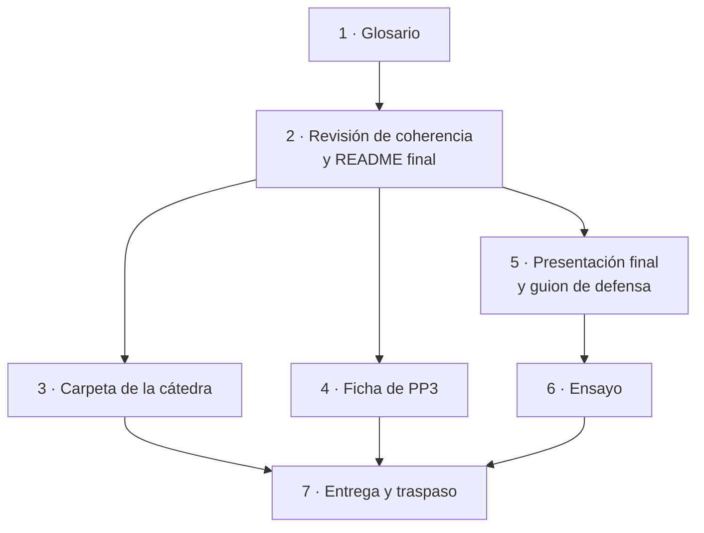
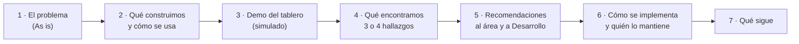

# Plan 8 · Cierre: glosario, carpeta de la cátedra, Ficha de PP3 y presentación final

> **Para quien lo ejecuta (persona o agente):** seguí las tareas en orden y marcá cada casilla `- [ ]`. Este plan es
> sobre todo de documentos y coordinación: no lleva TDD salvo en la Tarea 1. Si tu agente tiene skills para Word
> (`docx`), presentaciones (`pptx` o un tipo de artefacto de diapositivas) o documentos, usalas en las Tareas 4 y 5. Leé
> antes `../LEEME.md`, `pp2 devs/pp3/Guia_General_del_Alumno_v1.0.docx` (sección 4, la Ficha) y la sección «Al cerrar
> PP3» de `pp2 devs/pp3/Guia_Detallada_PP3_v1.0.docx`.

**Objetivo:** dejar el proyecto completo para la cátedra y para la entidad: documentación coherente y en lenguaje llano,
la carpeta `VIVSO_PP_ITSE` con lo que pide la plantilla para PP3, la Ficha de PP3 al día y la presentación profesional
final a la Subsecretaría, ensayada.

**Arquitectura:** el repositorio `vivso-analitica` es la fuente; la carpeta de la cátedra (`VIVSO_PP_ITSE/`, que el grupo
sube a su Drive) recibe copias de los documentos de las Etapas 6 a 9, un README que apunta al código y el material de la
entrega. La presentación cuenta el recorrido completo (de PP1 a PP3) con foco en decisiones de gestión.

**Especificación:** `../especificacion.md`, sección 15 (documentos y su copia a la carpeta de la cátedra).

**Depende de:** todos los planes anteriores (las Tareas 1, 3 y 4 se pueden empezar antes, con lo que haya).

## Restricciones globales

- Todo en español y en **lenguaje llano**: el profesor devolvió dos veces que lo entregado era «demasiado técnico»;
  cada término técnico se explica la primera vez o va al glosario.
- **Ningún dato real** en la carpeta de la cátedra, en la presentación ni en la demo: ni nombres, ni DNI, ni números de
  expediente reales. Las capturas se toman con el simulado.
- Sin «no se puede» tajante: decir qué adaptación o qué dato haría falta.
- Los documentos del repositorio siguen sin «Plan N», «Claude», «superpowers» ni el host de Aiven.
- Commits en español, sin coautoría ni menciones a IA.

## Foco de revisión

1. **Coherencia entre lo que se definió en PP1 y lo que se muestra al final** (la guía lo marca como parte de lo que se
   evalúa): el problema, el objetivo y el valor para la entidad de la Ficha de PP2 tienen que reconocerse en la
   presentación, y los cambios de rumbo (de VISOC al sistema nuevo, del AFO de rubros al AFO de etapas) se explican.
2. **Cifras distintas entre documentos** (ya pasó en PP2): toda cifra de la presentación sale de los documentos de las
   Etapas 6 y 7 y de `salidas/evaluacion/resultados.md` con su fecha.
3. **Una captura del tablero con datos de personas reales:** solo capturas del simulado.
4. **La Etapa 9 presentada como hecha cuando es condicional:** decir exactamente qué funciona hoy y qué es propuesta.
5. **Pendientes externos sin dueño** (credenciales de Aiven, respuestas de Desarrollo, devolución del área): cada uno
   con quién lo sigue y qué se hace si no llega.

## Mapa



---

### Tarea 1: Glosario (`docs/glosario.md`)

**Archivos:** `docs/glosario.md`, `docs/README.md`, `README.md`, `tests/test_documentos.py`

Términos (cada uno en una o dos oraciones, sin jerga, con un ejemplo cuando ayude): AFO, API, base propia, calendario
de días hábiles, clave de acceso, confianza (confirmado, inferido, sin confirmar), capacidad (disponible, parcial, no
disponible), corrida, datos simulados, días hábiles, Docker, etapa de obra, evento, expediente, feriado, grupo OG / ONG,
historia, indicador, línea de tiempo, modo sin conexión, notificación, observación, origen (simulado, base real,
vacío), prórroga, rechazo, ronda, semáforo, sincronización, tablero, técnico asignado, versión, visita inicial.

- [ ] **Paso 1: prueba que falla** en `tests/test_documentos.py`:

```python
TERMINOS = ("AFO", "API", "Corrida", "Etapa de obra", "Grupo OG / ONG", "Indicador", "Notificación", "Prórroga",
            "Ronda", "Semáforo", "Sincronización", "Técnico asignado")

def test_el_glosario_explica_los_terminos_principales():
    texto = (RAIZ / "docs" / "glosario.md").read_text(encoding="utf-8")
    assert all(f"**{termino}**" in texto for termino in TERMINOS)
```

- [ ] **Paso 2:** correr → falla. **Paso 3:** escribir el glosario (cada término en negrita al principio de su
  entrada), sumarlo al índice y enlazarlo desde el README y desde los documentos de las Etapas 6 a 9 («ver el glosario»).
- [ ] **Paso 4:** suite en verde. **Paso 5: commit** `"Agregar el glosario del proyecto"`.

### Tarea 2: Revisión de coherencia y README final

**Archivos:** `README.md`, `docs/*.md`

- [ ] **Paso 1:** recorrer todos los documentos con esta lista y corregir lo que haga falta:
  - «14 tablas» en todos lados; nada que presente la etapa trabada como actual (pasó hasta el 31/10/2026).
  - El AFO es el de las 6 etapas; el AFO de rubros (15 o 17) quedó sin efecto en el sistema nuevo.
  - El tope de 2 visitas por obra no existe en el sistema nuevo (Desarrollo dejó sin efecto las visitas de obra).
  - Fechas y commits de referencia del sistema de Desarrollo iguales en todos los documentos.
  - Cada enlace funciona (lo controla `test_los_enlaces_relativos_existen`) y cada documento está en el índice.
  - Los números de los documentos coinciden con `salidas/evaluacion/resultados.md`.
- [ ] **Paso 2:** README final: «Estado» dice qué está completo y qué queda pendiente por causas externas (con la causa);
  «Uso» con los comandos de punta a punta (`simular`, `sincronizar`, `api`, `streamlit run`, `salud`, `informe`,
  `evaluar`, `docker compose up`), el enlace a la demo y a cada documento; un diagrama general actualizado.
- [ ] **Paso 3:** pedirle a alguien del grupo que lea el README sin conocer el código y anotar lo que no entendió.
- [ ] **Paso 4:** suite en verde. **Paso 5: commit** `"Revisar la coherencia de la documentación y cerrar el README"`.

### Tarea 3: Carpeta de la cátedra (`VIVSO_PP_ITSE/`)

La carpeta sigue la plantilla de la cátedra (`pp2 devs/pp3/Plantilla_Carpetas_PP_ITSE_v1.0/`). Lo de PP1 y PP2 ya está;
para PP3:

| Carpeta | Qué va | Cómo |
| :--- | :--- | :--- |
| `01_Documentacion_Metodologia/Etapa_6_Evaluacion` | `etapa-6-evaluacion.md` y su PDF | copiar del repositorio; exportar a PDF (vista previa de Markdown de VS Code → imprimir a PDF, o `pandoc`), revisando que los diagramas se vean |
| `…/Etapa_7_Insights` | `etapa-7-insights.md` y su PDF | ídem |
| `…/Etapa_8_Despliegue` | `etapa-8-despliegue.md` y su PDF | ídem |
| `…/Etapa_9_Monitoreo` | `etapa-9-monitoreo.md` y su PDF, con la aclaración de que es condicional | ídem |
| `03_Datos/Procesados` | las 14 tablas del simulado (`python -m analitica simular --hasta 2026-10-15 --csv …`) en una subcarpeta `Simulados_PP3` con un `LEEME.txt` («datos generados por el grupo, no obtenidos») y las tablas de `salidas/evaluacion/` | nunca datos reales |
| `04_Notebooks_Codigo` | `README.md`: qué es `vivso-analitica`, el enlace al repositorio, cómo instalarlo y correrlo, y que `vivso-python` es el antecedente de PP1 y PP2 | escribir |
| `05_Modelos` | `README.txt`: no hay un modelo entrenado; la solución son reglas, indicadores y un simulador que sirve de verdad para evaluarlos (y dónde está cada cosa) | escribir |
| `06_Entregables/PP3_Presentacion_Final` | la presentación (Tarea 5) en `.pptx` y PDF, y el guion | Tarea 5 |
| `02_Fichas_de_Seguimiento/Ficha_PP3` | la Ficha (Tarea 4) | Tarea 4 |

- [ ] **Paso 1:** copiar y exportar los cuatro documentos de las etapas.
- [ ] **Paso 2:** generar los CSV del simulado y armar `Simulados_PP3` con su `LEEME.txt`.
- [ ] **Paso 3:** escribir los README de `04_Notebooks_Codigo` y `05_Modelos`.
- [ ] **Paso 4:** actualizar `INDICE.md` de la carpeta (si existe) con lo nuevo.
- [ ] **Paso 5:** revisar que no haya ningún archivo con datos reales (DNI, nombres, expedientes reales) en lo que se
  suba al Drive; los exports de VISOC y GDE de PP2 siguen afuera, como se decidió.
- [ ] **Paso 6:** subir al Drive del grupo (la carpeta no es un repositorio).

### Tarea 4: Ficha de PP3

**Archivos:** `VIVSO_PP_ITSE/02_Fichas_de_Seguimiento/Ficha_PP3/Ficha proyecto PP3.docx`

Partir de `Ficha_PP2/Ficha proyecto PP2.docx` (mismo formato, si el profesor no dio otro) y actualizar:

- **Encabezado:** Práctica Profesionalizante III, cuatrimestre y año.
- **Dónde estamos:** etapas 1 a 5 completadas; 6, 7 y 8 con su estado real según la guía general (`No iniciada`, `En
  curso`, `En espera`, `Bloqueada`, `Completada`, `Reabierta`); 9 «condicional» (se activa solo si se implementa la
  propuesta de la Etapa 8). Si algo está frenado por terceros (por ejemplo, la lectura real por falta de credenciales),
  **marcarlo `Bloqueada` y decir por qué**, como pide la guía.
- **Hitos de PP3:** las fechas que fije el profesor (pedirlas si no están) y la presentación final.
- **Identidad del problema:** el mismo problema; el objetivo y el valor para la entidad actualizados al servicio de
  analítica sobre el sistema nuevo (VIVSO), con una oración que explique el cambio de rumbo de octubre (de los reportes
  de VISOC al sistema que construye Desarrollo).
- **Datos del proyecto:** fuente (la base del sistema de Desarrollo, leída con un usuario de solo lectura; mientras no
  hay acceso, el simulado), formato (14 tablas), volumen (el del simulado y el real si se leyó), problemas conocidos
  (sección 3.4 de la especificación, en lenguaje llano).
- **Stack técnico:** Python 3.13, pandas, SQLAlchemy, FastAPI, Streamlit, Docker; tipo de solución: indicadores con
  reglas transparentes y un simulador para evaluarlos (no hay modelo entrenado).

- [ ] **Paso 1:** pedir al profesor el formato de la Ficha de PP3 (si es distinto) y las fechas de los hitos.
- [ ] **Paso 2:** completar la Ficha y revisarla entre todos.
- [ ] **Paso 3:** guardarla en la carpeta y subirla.

### Tarea 5: Presentación final a la entidad y guion de defensa

**Archivos:** `VIVSO_PP_ITSE/06_Entregables/PP3_Presentacion_Final/` (presentación y guion)

Es el entregable formal de PP3: una **presentación profesional a la Subsecretaría** (no solo al profesor), con foco en
decisiones de gestión y no en el código. Estructura sugerida (12 a 15 diapositivas, 15 a 20 minutos más preguntas):



1. **El problema** (2 diapositivas): cómo se sigue hoy una obra; qué no se ve (la historia, quién está demorado, las
   aprobaciones sin fotos). Conectar con lo que se definió en PP1 (Ficha de PP2: problema, objetivo, valor).
2. **Qué construimos** (2): el servicio en un diagrama simple (sistema de Desarrollo → servicio → tablero y API), qué
   lee y qué no (datos personales, familias solo en conteos), por qué hay un simulado.
3. **Demo** (3 a 5 minutos): el tablero con el simulado: Resumen → Obras (una obra vencida, su línea de tiempo) →
   Etapas → Calidad de los datos. Tener capturas de respaldo por si falla internet.
4. **Qué encontramos** (3): los 3 o 4 hallazgos priorizados de la Etapa 7, cada uno con su resultado, su
   interpretación y su fuente (sistema real o simulado).
5. **Recomendaciones** (1 o 2): «hoy pasa X → con Y pasaría Z», para el área y para Desarrollo.
6. **Cómo se implementa** (1): la propuesta de la Etapa 8 (recursos, acceso, datos personales, quién lo mantiene) y
   qué se monitorea (Etapa 9, condicional).
7. **Evaluación y límites** (1): los criterios de la Etapa 6 con su resultado y las condiciones de validez, en una tabla
   simple; lo pendiente y por qué.
8. **Qué sigue** (1): lo que queda del lado del área y de Desarrollo; cómo seguir sin el grupo.

- [ ] **Paso 1:** armar la presentación (PowerPoint, Google Slides o la herramienta que use el grupo) con las cifras
  de los documentos de las Etapas 6 y 7; diagramas simples (se pueden exportar los Mermaid a imagen).
- [ ] **Paso 2:** escribir el **guion como mapa de defensa, no como libreto** (lo que funcionó en PP2): por cada
  diapositiva, la idea principal y los datos que la respaldan, y una lista de preguntas probables con la respuesta
  corta: ¿por qué un simulado? ¿qué cambia con datos reales? ¿quién lo mantiene cuando termine la práctica? ¿qué pasa
  con los datos personales? ¿qué le cambia al técnico o a la organización? ¿por qué no un modelo de aprendizaje
  automático? ¿cuánto cuesta implementarlo?
- [ ] **Paso 3:** revisar que no haya datos reales en ninguna diapositiva ni captura.
- [ ] **Paso 4:** exportar a PDF y guardar todo en la carpeta.

### Tarea 6: Ensayo

- [ ] **Paso 1:** confirmar la fecha y el formato con el profesor y, si se puede, con el referente del área.
- [ ] **Paso 2:** repartir las partes (una por integrante) y ensayar con el protocolo de PP2: leer una vez, explicar sin
  mirar, preguntas cruzadas entre integrantes.
- [ ] **Paso 3:** ensayar la demo en la computadora y la red que se van a usar; tener el tablero corriendo en local por
  si la demo pública no carga.
- [ ] **Paso 4:** ajustar la presentación con lo que salga del ensayo.

### Tarea 7: Entrega y traspaso

- [ ] **Paso 1:** mandar a Desarrollo, por el canal de siempre: el pedido actualizado (`docs/pedido-a-desarrollo.md`),
  `docs/api.md` y, por privado, las claves si van a consumir la API.
- [ ] **Paso 2:** dejar al área el informe de la Etapa 8 (propuesta) y la guía del tablero (`docs/tablero.md`).
- [ ] **Paso 3:** acordar y dejar escrito (en `docs/etapa-8-despliegue.md`) quién queda a cargo después de PP3, quién
  conserva las claves y qué pasa con el acceso del grupo a la base de Desarrollo.
- [ ] **Paso 4:** actualizar el «Estado» de `../LEEME.md` y de la Ficha de PP3; etiquetar la versión entregada en el
  repositorio (`git tag -a pp3-entrega -m "Entrega final de PP3"`).
- [ ] **Paso 5: commit** final si quedó algo `"Cerrar la entrega de PP3"`.

---

## Decisiones para tomar al revisar

1. **Formato de los documentos en la carpeta de la cátedra:** Markdown y PDF (recomendado) o Word.
2. **Quién presenta qué:** una parte por integrante (recomendado) o dos voceros.
3. **Demo:** pública con el simulado y capturas de respaldo (recomendado), o solo capturas.
